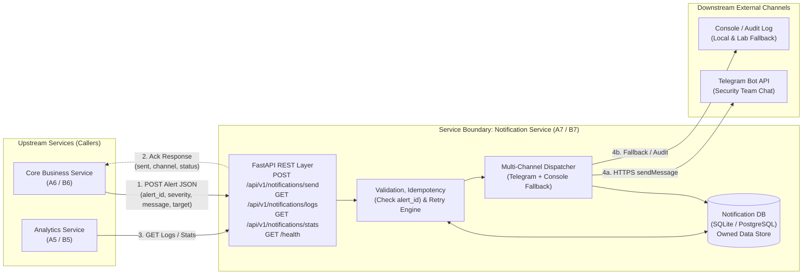

# Service Boundary — Notification Service

## 1. Thông tin nhóm & Tên Service (Context and Ownership)

- **Tên Service:** **Notification Service** (`notification-service`)
- **Tên nhóm:** Nhóm A7 — Product A *(hoặc B7 — Product B)*
- **Lớp:** FIT4110 – Dịch vụ kết nối và Công nghệ nền tảng
- **Thành viên nhóm:**
  1. `<Họ tên TV 1>` – `<MSSV 1>` (Service Lead)
  2. `<Họ tên TV 2>` – `<MSSV 2>` (API/Contract Owner)
  3. `<Họ tên TV 3>` – `<MSSV 3>` (Backend Developer)
  4. `<Họ tên TV 4>` – `<MSSV 4>` (Test & DevOps Owner)
- **Sản phẩm tổng thể của lớp:** **Smart Campus Operations Platform** (Nền tảng vận hành khuôn viên trường đại học thông minh)
- **Công nghệ dự kiến:** Python 3.11 + FastAPI, SQLite / PostgreSQL, `httpx` (gọi Telegram Bot API), Docker & Docker Compose.

---

## 2. Bài toán Service giải quyết (Problem Statement)

Trong hệ thống **Smart Campus Operations Platform**, khi các sự kiện bất thường xảy ra (nhiệt độ phòng máy vượt ngưỡng, phát hiện người lạ ở khu vực cấm qua AI Vision, hoặc quẹt thẻ RFID trái phép ngoài giờ), `Core Business Service` sẽ đánh giá luật nghiệp vụ và sinh ra cảnh báo (`alert`).

Tuy nhiên, `Core Business Service` chỉ tập trung vào logic quyết định nghiệp vụ chứ không trực tiếp quản lý kết nối tới từng nền tảng nhắn tin bên ngoài hay xử lý việc gửi lại khi mạng lỗi. **Notification Service** giải quyết bài toán này bằng cách:
- Đóng vai trò là cổng điều phối và gửi thông báo tập trung (đa kênh: **Telegram Bot API** kết hợp **Console/Database Log** làm kênh dự phòng/kiểm toán).
- Đảm bảo tính tin cậy khi gửi thông báo thông qua cơ chế **chống gửi trùng (idempotency / deduplication theo `alert_id` hoặc `idempotency_key`)** và **thử lại đơn giản (retry với backoff)** khi kênh bên ngoài tạm thời gián đoạn.
- Lưu trữ lịch sử và trạng thái gửi (`delivered`, `failed`, `retrying`, `duplicate_ignored`) để phục vụ tra cứu vận hành và cung cấp số liệu thống kê cho `Analytics Service`.

---

## 3. Actor (Các tác nhân tương tác)

| Actor / Hệ thống | Vai trò | Mô tả tương tác với Notification Service |
|---|---|---|
| **Core Business Service** | Upstream Service (Consumer của Notification API) | Gửi yêu cầu phát cảnh báo (`POST /api/v1/notifications/send` hoặc `POST /notifications`) ngay khi phát hiện sự kiện bất thường. |
| **Analytics Service** | Upstream Consumer (Đọc dữ liệu thống kê) | Gọi API của Notification Service (`GET /api/v1/notifications/logs` hoặc `GET /api/v1/notifications/stats`) để tổng hợp số lượng thông báo đã gửi, tỷ lệ thành công/thất bại theo ngày và theo mức độ nghiêm trọng. |
| **External Notification Providers (Telegram Bot API / Webhook)** | Downstream External Dependency | Nền tảng bên thứ ba nhận HTTP request từ Notification Service để chuyển tin nhắn thực tế tới nhóm trực ban. |
| **Đội bảo vệ / Quản trị viên (Security Team / Campus Admin)** | End-user (Người nhận cuối) | Nhận tin nhắn cảnh báo thời gian thực trên Telegram / kênh thông báo để xử lý sự cố tại hiện trường. |
| **API Gateway / Operations** | Platform Component | Gọi `GET /health` để giám sát trạng thái sẵn sàng của container và định tuyến request. |

---

## 4. System Boundary & Service Boundary (Responsibility & Out of Scope)

### 4.1. System Boundary (Phạm vi trong toàn hệ thống Smart Campus)
- **Phần nhóm kiểm soát (We Own):**
  - Toàn bộ mã nguồn, hợp đồng API (`openapi.yaml`), cơ sở dữ liệu lưu lịch sử gửi thông báo (`notification_logs`) và cấu hình kết nối kênh gửi của **Notification Service**.
  - Logic kiểm tra hợp lệ payload cảnh báo, chống gửi trùng (`alert_id`), cơ chế retry khi gọi Telegram API lỗi, và ghi log trạng thái gửi.
- **Phần nhóm chỉ tích hợp (Integrated Only):**
  - Nhận request cảnh báo từ `Core Business Service` theo hợp đồng REST API đã thống nhất.
  - Cung cấp API truy vấn lịch sử/thống kê thông báo cho `Analytics Service`.
  - Gọi ra dịch vụ ngoài `Telegram Bot API` (hoặc mock/console fallback khi chạy ở môi trường cô lập không có Internet).

### 4.2. Responsibility (Trách nhiệm của Notification Service)
1. **Tiếp nhận yêu cầu gửi cảnh báo** từ `Core Business Service` qua HTTP REST API.
2. **Kiểm tra tính hợp lệ (Validation)** của dữ liệu đầu vào (`alert_id`, `severity`, `message`, `target`, `channel`).
3. **Chống gửi trùng (Deduplication / Idempotency):** Kiểm tra xem `alert_id` đã được gửi thành công trong khoảng thời gian cấu hình (hoặc theo khoá `alert_id`) chưa để tránh spam nhiều tin nhắn giống hệt nhau cho đội bảo vệ.
4. **Định tuyến & Gửi thông báo (Channel Dispatch):** Chuyển đổi nội dung cảnh báo thành định dạng phù hợp và gửi qua kênh được cấu hình (**Telegram Bot API** và/hoặc **Console/DB Log**).
5. **Xử lý lỗi & Retry đơn giản:** Nếu gọi Telegram API gặp lỗi mạng hoặc timeout (`5xx` / network error), tự động thử lại tối đa $N$ lần (ví dụ 2–3 lần) và chuyển sang fallback ghi log cảnh báo nếu vẫn thất bại.
6. **Ghi nhận lịch sử (Audit Logging):** Lưu toàn bộ trạng thái gửi (`queued`, `delivered`, `failed`, `duplicate_ignored`), thời gian gửi, kênh gửi và mã lỗi (nếu có) vào Database.
7. **Cung cấp dữ liệu cho Analytics:** Mở các endpoint cho phép tra cứu danh sách log thông báo và thống kê tổng hợp theo ngày/kênh/mức độ nghiêm trọng.

### 4.3. Out of Scope (Những việc Notification Service KHÔNG làm)
- **KHÔNG** nhận dữ liệu thô trực tiếp từ cảm biến IoT (ESP32), Camera IP hay đầu đọc thẻ RFID.
- **KHÔNG** chạy mô hình AI nhận diện hình ảnh hay phân tích video frame.
- **KHÔNG** tự đánh giá luật nghiệp vụ (ví dụ: không tự quyết định nhiệt độ $31.5^\circ\text{C}$ có vượt ngưỡng hay không, không kiểm tra giờ mở cửa cổng). Việc ra quyết định khi nào tạo cảnh báo thuộc toàn quyền của `Core Business Service`.
- **KHÔNG** quản lý danh tính sinh viên/nhân viên hoặc phân quyền ra/vào cổng (`Access Gate Service`).

---

## 5. Input / Output Contract

### 5.1. Dữ liệu đầu vào (Input — Nhận từ Core Business Service)

| Field | Type | Required | Ý nghĩa & Ràng buộc |
|---|---|---|---|
| `alert_id` | `string` | Có | Mã định danh duy nhất của cảnh báo từ Core Business (ví dụ: `"ALT-001"`), dùng để truy vết và chống gửi trùng. |
| `type` | `string` | Không | Loại sự kiện cảnh báo (ví dụ: `"unauthorized_access"`, `"high_temperature"`, `"intrusion_detected"`). |
| `severity` | `string` (enum) | Có | Mức độ nghiêm trọng: `"low"`, `"medium"`, `"high"`, `"critical"`. |
| `message` | `string` | Có | Nội dung thông báo chi tiết cần gửi tới người phụ trách (tối thiểu 1 ký tự, tối đa 1000 ký tự). |
| `target` | `string` | Có | Nhóm hoặc người nhận mục tiêu (ví dụ: `"security_team"`, `"facility_manager"`, `"admin"`). |
| `channel` | `string` (enum) | Không | Kênh chỉ định: `"telegram"`, `"console"`, `"webhook"` (mặc định: `"telegram"` kèm `"console"` fallback). |
| `timestamp` | `string` (ISO 8601) | Không | Thời điểm phát sinh cảnh báo (ví dụ: `"2026-05-02T09:10:00Z"`). |

**Ví dụ JSON Request Body (`POST /api/v1/notifications/send`):**
```json
{
  "alert_id": "ALT-001",
  "type": "intrusion_detected",
  "severity": "high",
  "message": "Unknown person detected near main gate",
  "target": "security_team",
  "channel": "telegram",
  "timestamp": "2026-05-02T09:10:00Z"
}
```

### 5.2. Dữ liệu đầu ra (Output — Trả về cho Core Business & Analytics)

**Ví dụ JSON Response khi gửi thành công (`200 OK` / `201 Created`):**
```json
{
  "notification_id": "NTF-20260502-0001",
  "alert_id": "ALT-001",
  "sent": true,
  "channel": "telegram",
  "status": "delivered",
  "retry_count": 0,
  "delivered_at": "2026-05-02T09:10:01Z"
}
```

**Ví dụ JSON Response khi phát hiện gửi trùng (`200 OK` — Idempotent response):**
```json
{
  "notification_id": "NTF-20260502-0001",
  "alert_id": "ALT-001",
  "sent": false,
  "channel": "telegram",
  "status": "duplicate_ignored",
  "message": "Alert ALT-001 was already delivered previously",
  "delivered_at": "2026-05-02T09:10:01Z"
}
```

**Ví dụ JSON Error Response khi dữ liệu không hợp lệ (`400 Bad Request` / `422 Unprocessable Entity` theo chuẩn Problem Details):**
```json
{
  "type": "https://smartcampus.edu.vn/errors/invalid-notification-payload",
  "title": "Invalid notification request payload",
  "status": 400,
  "detail": "Field 'severity' must be one of: low, medium, high, critical."
}
```

---

## 6. Provider / Consumer & Upstream / Downstream (Bảng "Ai gọi ai")

| Quan hệ | Tên Service / Thành phần | Vai trò trong giao tiếp | Giao thức | Mục đích kết nối |
|---|---|---|---|---|
| **Upstream Caller** | `Core Business Service` (A6/B6) | **Consumer** gọi vào **Provider** (`Notification Service`) | HTTP REST (`POST`) | Gửi cảnh báo (`alert`) sang Notification Service khi phát hiện vi phạm quy tắc nghiệp vụ. |
| **Upstream Caller** | `Analytics Service` (A5/B5) | **Consumer** gọi vào **Provider** (`Notification Service`) | HTTP REST (`GET`) | Lấy danh sách log thông báo và số liệu thống kê (tổng số thông báo, phân bổ theo kênh/mức độ) để lên báo cáo. |
| **Upstream Caller** | `API Gateway` (nếu có) | **Reverse Proxy / Caller** | HTTP REST | Chuyển tiếp request từ hệ thống chung và kiểm tra `GET /health`. |
| **Downstream Dependency** | `Telegram Bot API` (`api.telegram.org`) | **External Provider** được `Notification Service` gọi tới | HTTPS REST (`POST /bot<token>/sendMessage`) | Chuyển phát tin nhắn cảnh báo thực tế tới nhóm Telegram của đội bảo vệ/vận hành. |
| **Internal Dependency** | `Notification Database` (SQLite / PostgreSQL) | **Owned Data Store** của `Notification Service` | SQL | Lưu trữ bảng `notification_logs` để đảm bảo idempotency (`alert_id`) và phục vụ truy vấn lịch sử. |

---

## 7. Danh sách API dự kiến (Candidate API)

| Method | Endpoint | Mục đích | Caller (Consumer) | Status Codes chính |
|---|---|---|---|---|
| `GET` | `/health` | Kiểm tra trạng thái sống và kết nối DB của service | Docker Healthcheck, API Gateway, Operations | `200 OK`, `503 Service Unavailable` |
| `POST` | `/api/v1/notifications/send` | Nhận cảnh báo từ Core Business và gửi thông báo qua kênh đích | `Core Business Service` | `201 Created`, `200 OK` (trùng `alert_id`), `400 Bad Request`, `401 Unauthorized`, `502 Bad Gateway` |
| `GET` | `/api/v1/notifications/logs` | Truy vấn lịch sử gửi thông báo (hỗ trợ lọc theo `date`, `severity`, `status`, `alert_id`) | `Analytics Service`, Admin | `200 OK`, `400 Bad Request` |
| `GET` | `/api/v1/notifications/logs/{notification_id}` | Xem chi tiết trạng thái gửi và số lần retry của một thông báo cụ thể | `Core Business Service`, Admin | `200 OK`, `404 Not Found` |
| `GET` | `/api/v1/notifications/stats` | Trả về thống kê tổng hợp số lượng thông báo theo trạng thái và mức độ nghiêm trọng | `Analytics Service` | `200 OK` |

---

## 8. Event dự kiến & Hành vi khi lỗi (Failure & Degraded-Mode Behavior)

- **Event dự kiến (nếu mở rộng kết hợp Message Queue ở Buổi 5):**
  - Có thể lắng nghe thêm sự kiện `alert.created` trên exchange/queue của RabbitMQ từ `Core Business Service` và phát sự kiện `notification.delivery_updated` cho `Analytics Service`.
- **Hành vi khi lỗi (Failure & Degraded Mode):**
  - **Khi thiếu cấu hình `TELEGRAM_BOT_TOKEN` hoặc mất kết nối Internet ra Telegram:** Service không bị crash mà tự động chuyển sang chế độ **Fallback (`console` / `mock` log)**, ghi nhận đầy đủ nội dung cảnh báo vào Database + stdout với trạng thái `delivered_fallback` (hoặc `failed` kèm lý do rõ ràng tuỳ cấu hình `ALLOW_CONSOLE_FALLBACK=true`), giúp hệ thống vẫn demo và kiểm thử độc lập được trong phòng lab.
  - **Khi Telegram trả lỗi tạm thời (`429 Too Many Requests` hoặc `5xx`):** Thực hiện retry tối đa `MAX_RETRIES=2` lần với khoảng nghỉ ngắn trước khi ghi nhận trạng thái cuối cùng.

---

## 9. Sơ đồ Service Boundary (Boundary Diagram)



---

## 10. Vấn đề cần đàm phán ở Buổi 2 (Open Questions for Contract Negotiation)

1. **Chuẩn hóa danh sách `severity` và `target` với nhóm Core Business (A6/B6):** Thống nhất chính xác các giá trị enum của `severity` (`low | medium | high | critical`) và danh sách `target` (`security_team`, `facility_manager`, `it_support`) để ánh xạ đúng sang `chat_id` trên Telegram.
2. **Cơ chế chống gửi trùng (Idempotency):** Thống nhất với `Core Business Service` xem khi `alert_id` bị gửi lặp lại, `Notification Service` sẽ trả về `200 OK` (kèm `"status": "duplicate_ignored"`) hay `409 Conflict` để `Core Business` không coi đó là lỗi hệ thống.
3. **Đồng bộ hay Bất đồng bộ khi gọi `/notifications/send`:** Thống nhất thời gian timeout tối đa (ví dụ `3s`) khi `Core Business` gọi sang `Notification Service` (trả về `201 Created` sau khi gửi xong hay `202 Accepted` khi đưa vào hàng đợi xử lý nền).
4. **Hợp đồng dữ liệu thống kê với nhóm Analytics (A5/B5):** Thống nhất cấu trúc query parameter (`?date=YYYY-MM-DD`) và JSON response của `GET /api/v1/notifications/stats` để khớp với báo cáo tổng hợp của `Analytics Service`.
5. **Cơ chế xác thực liên service (Authentication):** Thống nhất dùng header `X-API-Key` hay `Authorization: Bearer <token>` đặt trong file `.env` khi `Core Business` và `Analytics` gọi sang `Notification Service`.
6. **Chuẩn định dạng lỗi (Error Model):** Thống nhất sử dụng chuẩn RFC 9457 / RFC 7807 (`application/problem+json` gồm `type`, `title`, `status`, `detail`) cho mọi phản hồi `4xx`/`5xx`.
