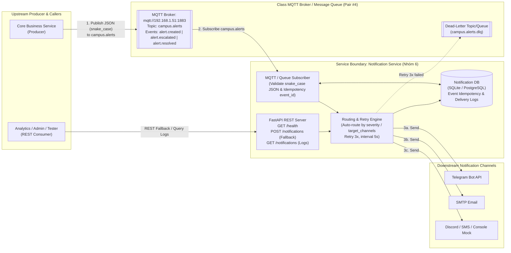

# Service Boundary — Notification Service

## 1. Thông tin nhóm & Tên Service (Context and Ownership)

- **Tên Service:** **Notification Service** (`notification-service`)
- **Tên nhóm:** Nhóm 6 *(hoặc A7 / B7 theo danh sách phân nhóm)* — Phụ trách **Notification Service**
- **Cặp phụ thuộc chính (theo `pairing-matrix.md` & `event-contract-04-core-notification.md`):** **Pair #4: Core Business → Notification Service**
- **Lớp:** FIT4110 – Dịch vụ kết nối và Công nghệ nền tảng
- **Thành viên nhóm:**
  1. `<Họ tên TV 1>` – `<MSSV 1>` (Service Lead)
  2. `<Họ tên TV 2>` – `<MSSV 2>` (API & Event Contract Owner)
  3. `<Họ tên TV 3>` – `<MSSV 3>` (Backend Developer)
  4. `<Họ tên TV 4>` – `<MSSV 4>` (Test & DevOps Owner)
- **Sản phẩm tổng thể của lớp:** **Smart Campus Operations Platform** (Nền tảng vận hành khuôn viên trường đại học thông minh)
- **Công nghệ dự kiến:** Python 3.11 + FastAPI, MQTT Subscriber (`paho-mqtt` kết nối tới Broker `mqtt://192.168.1.51:1883` / Eclipse Mosquitto hoặc RabbitMQ), SQLite / PostgreSQL, `httpx` / `smtplib` (gửi Telegram Bot API, Email, Discord, SMS mock), Docker & Docker Compose.

---

## 2. Bài toán Service giải quyết (Problem Statement)

Trong hệ thống **Smart Campus Operations Platform**, khi các sự kiện bất thường xảy ra (nhiệt độ vượt ngưỡng từ IoT, phát hiện người lạ qua AI Vision, hoặc truy cập trái phép tại Access Gate), `Core Business Service` sẽ đánh giá luật nghiệp vụ, tạo cảnh báo (`Alert`) và phát sự kiện bất đồng bộ lên Message Broker.

**Notification Service** giải quyết bài toán chuyển phát cảnh báo đa kênh tách biệt hoàn toàn khỏi luồng xử lý trung tâm của `Core Business`:
- **Lắng nghe sự kiện bất đồng bộ (Async Subscriber):** Subscribe trực tiếp vào topic `campus.alerts` trên **MQTT Broker chung của lớp (`mqtt://192.168.1.51:1883`, Anonymous)** (hoặc Queue tương đương trong môi trường Docker Compose local) để nhận 3 loại sự kiện từ `Core Business`:
  - `alert.created` → Gửi cảnh báo mới phát sinh.
  - `alert.escalated` → Gửi thông báo nhắc nhở với mức độ leo thang cao hơn (`escalation_level`) khi cảnh báo chưa được xử lý sau thời gian quy định.
  - `alert.resolved` → Gửi thông báo xác nhận sự cố đã được giải quyết kèm ghi chú (`resolution_note`).
- **Định tuyến & gửi đa kênh (`telegram`, `email`, `discord`, `sms`):** Hỗ trợ gửi theo danh sách `target_channels` do `Core Business` chỉ định hoặc tự động định tuyến kênh dựa trên mức độ nghiêm trọng (`severity`: `low`, `medium`, `high`, `critical`).
- **Đảm bảo độ tin cậy:** Chống gửi trùng (**idempotent theo `event_id`**), tự động **retry 3 lần (interval 5s)** khi kênh gửi gặp lỗi tạm thời, đẩy vào **Dead-Letter Queue (DLQ)** nếu vẫn thất bại, và cung cấp **REST API fallback/tra cứu** (`POST /notifications`, `GET /notifications`, `GET /health`).

---

## 3. Actor (Các tác nhân tương tác)

| Actor / Hệ thống | Vai trò | Cơ chế giao tiếp | Mô tả tương tác với Notification Service |
|---|---|---|---|
| **Core Business Service** | Upstream Partner (**Pair #4** — Event Producer) | **Async Pub/Sub** qua MQTT Broker (`mqtt://192.168.1.51:1883`) / Queue `campus.alerts` | Publish các sự kiện `alert.created`, `alert.escalated`, `alert.resolved` (định dạng JSON `snake_case`) lên topic `campus.alerts`. |
| **MQTT Broker / Message Queue (`campus.alerts`)** | Platform Component (Trung gian truyền thông điệp) | MQTT (`1883`, Anonymous) / AMQP | Nhận event từ `Core Business` và đẩy tới Subscriber của `Notification Service` qua topic `campus.alerts`. |
| **External Notification Channels (Telegram / Email / Discord / SMS)** | Downstream External Dependencies | HTTPS REST / SMTP / Mock Log | Nhận yêu cầu từ `Notification Service` để gửi thông báo thực tế tới người phụ trách. |
| **Đội bảo vệ / Quản trị viên (Security Team / Admin)** | End-user (Người nhận cuối) | Telegram / Email / SMS | Nhận cảnh báo mới (`alert.created`), cảnh báo leo thang (`alert.escalated`) và thông báo đóng sự cố (`alert.resolved`). |
| **Analytics Service / Admin / Test Runner** | Upstream REST Consumer | HTTP REST (`GET /notifications`, `POST /notifications`, `GET /health`) | Gọi REST API để gửi thông báo thủ công (fallback/test), lấy log thông báo đã gửi hoặc kiểm tra healthcheck. |

---

## 4. System Boundary & Service Boundary (Responsibility & Out of Scope)

### 4.1. System Boundary (Phạm vi trong toàn hệ thống Smart Campus)
- **Phần nhóm kiểm soát (We Own):**
  - Toàn bộ mã nguồn của **Notification Service** (gồm MQTT/Queue Consumer Worker lắng nghe topic `campus.alerts` và FastAPI REST Server).
  - Hợp đồng sự kiện đã chốt với nhóm Core Business (`event-contract-04-core-notification.md`) và tài liệu OpenAPI 3.1 (`openapi.yaml`) của Notification Service.
  - Cơ sở dữ liệu riêng lưu trữ lịch sử gửi thông báo (`notifications` / `delivery_logs`) và bảng kiểm tra chống trùng theo `event_id`.
- **Phần nhóm chỉ tích hợp (Integrated Only):**
  - Subscribe vào MQTT Broker chung của lớp (`mqtt://192.168.1.51:1883`, topic `campus.alerts`) để nhận event từ `Core Business Service`.
  - Gọi ra Telegram Bot API / SMTP Email bên ngoài qua cấu hình `.env` (có fallback sang Console/DB Log khi chạy offline).

### 4.2. Responsibility (Trách nhiệm của Notification Service)
1. **Subscribe và tiêu thụ sự kiện trên topic `campus.alerts`:** Lắng nghe liên tục từ MQTT Broker (`mqtt://192.168.1.51:1883`) và phân nhánh xử lý theo `event_name`:
   - `alert.created`: Gửi cảnh báo mới theo `target_channels` hoặc tự định tuyến theo `severity`.
   - `alert.escalated`: Gửi lại thông báo với mức độ khẩn cấp cao hơn dựa trên `escalation_level`.
   - `alert.resolved`: Gửi tin nhắn thông báo sự cố đã được xử lý xong kèm `resolution_note`.
2. **Kiểm tra hợp lệ & Chống xử lý lặp (Validation & Idempotency):** Kiểm tra đầy đủ các trường bắt buộc (`event_id`, `event_name`, `correlationId`, `source`, `alert_id`, `timestamp`) và đảm bảo **idempotent theo `event_id`** (nếu `event_id` đã được xử lý thì bỏ qua, không gửi trùng).
3. **Định tuyến kênh gửi thông minh (Channel Routing):**
   - Nếu payload có `target_channels` (ví dụ `["telegram", "email", "sms"]`), gửi theo các kênh được yêu cầu.
   - Nếu không truyền `target_channels`, Notification Service tự động định tuyến kênh dựa trên `severity` (`low`, `medium`, `high`, `critical`).
4. **Cơ chế Retry & Dead-Letter Queue (DLQ):** Khi gửi thông báo bị lỗi, thực hiện **retry 3 lần với khoảng cách (interval) 5 giây**; nếu sau 3 lần vẫn thất bại thì ghi nhận `error_detail` và đẩy vào Dead-Letter Queue.
5. **Cung cấp REST API phụ trợ (Sync Fallback & Query):**
   - `POST /notifications`: Gửi thông báo thủ công (dùng cho fallback hoặc kiểm thử độc lập).
   - `GET /notifications`: Lấy danh sách log thông báo đã gửi (phục vụ Analytics / Admin).
   - `GET /health`: Kiểm tra trạng thái hoạt động của service và kết nối Broker/DB.

### 4.3. Out of Scope (Những việc Notification Service KHÔNG làm)
- **KHÔNG** nhận dữ liệu trực tiếp từ cảm biến IoT, Camera Stream hay Access Gate.
- **KHÔNG** chạy mô hình AI nhận diện hình ảnh.
- **KHÔNG** tự đánh giá luật nghiệp vụ để sinh cảnh báo hay tự tính toán thời gian leo thang (việc phát `alert.created`, `alert.escalated`, `alert.resolved` là trách nhiệm của `Core Business Service`).

---

## 5. Input / Output Contract (Theo đúng `event-contract-04-core-notification.md`)

### 5.1. Dữ liệu đầu vào Async (Subscribe từ Topic `campus.alerts` — Convention `snake_case`)

> **Quy ước đã chốt với nhóm Core Business:** Sử dụng cấu trúc JSON phẳng theo convention **`snake_case`** cho các trường của Notification, giữ nguyên tên trường **`correlationId`** để đồng bộ trace xuyên suốt các service của Core Business.

| Field | Type | Required | Áp dụng cho Event | Ý nghĩa & Ràng buộc |
|---|---|---|---|---|
| `event_id` | `string` (UUID) | Bắt buộc | Cả 3 event | Định danh duy nhất của event, dùng làm **Idempotency Key**. |
| `event_name` | `string` (enum) | Bắt buộc | Cả 3 event | Giá trị: `"alert.created"`, `"alert.escalated"`, `"alert.resolved"`. |
| `correlationId` | `string` | Bắt buộc | Cả 3 event | Mã truy vết xuyên service (ví dụ: `"req-0196fb3d-4ad7-7d1e-9f49-5d5148d2babc"`). |
| `source` | `string` | Bắt buộc | Cả 3 event | Luôn là `"core-business"`. |
| `alert_id` | `string` | Bắt buộc | Cả 3 event | Mã cảnh báo nghiệp vụ từ Core Business (ví dụ: `"ALT-001"`). |
| `timestamp` | `string` (ISO 8601) | Bắt buộc | Cả 3 event | Thời điểm phát sự kiện (ví dụ: `"2026-08-27T15:30:00Z"`). |
| `severity` | `string` (enum) | Bắt buộc với `alert.created` | `alert.created` | Mức độ nghiêm trọng: `"low"`, `"medium"`, `"high"`, `"critical"`. |
| `message` | `string` | Bắt buộc với `alert.created` | `alert.created` | Nội dung chi tiết của cảnh báo. |
| `target_channels` | `array<string>` | Tùy chọn | `alert.created` | Danh sách kênh nhận: `"telegram"`, `"email"`, `"discord"`, `"sms"`. Nếu thiếu, Notification tự định tuyến theo `severity`. |
| `escalation_level` | `integer` | Bắt buộc với `alert.escalated` | `alert.escalated` | Cấp độ leo thang của cảnh báo (ví dụ: `2`, `3`). |
| `resolution_note` | `string` | Bắt buộc với `alert.resolved` | `alert.resolved` | Ghi chú kết quả xử lý khi đóng cảnh báo. |

#### JSON mẫu 1: `alert.created` (Theo thông số đồng bộ từ Core Business)
```json
{
  "event_id": "123e4567-e89b-12d3-a456-426614174000",
  "event_name": "alert.created",
  "correlationId": "req-0196fb3d-4ad7-7d1e-9f49-5d5148d2babc",
  "source": "core-business",
  "alert_id": "ALT-001",
  "severity": "high",
  "message": "Phát hiện sự cố an ninh khẩn cấp từ Core Business",
  "target_channels": ["telegram", "email", "sms"],
  "timestamp": "2026-08-27T15:30:00Z"
}
```

#### JSON mẫu 2: `alert.escalated`
```json
{
  "event_id": "123e4567-e89b-12d3-a456-426614174001",
  "event_name": "alert.escalated",
  "correlationId": "req-0196fb3d-4ad7-7d1e-9f49-5d5148d2babc",
  "source": "core-business",
  "alert_id": "ALT-001",
  "escalation_level": 2,
  "timestamp": "2026-08-13T08:40:00+07:00"
}
```

#### JSON mẫu 3: `alert.resolved`
```json
{
  "event_id": "123e4567-e89b-12d3-a456-426614174002",
  "event_name": "alert.resolved",
  "correlationId": "req-0196fb3d-4ad7-7d1e-9f49-5d5148d2babc",
  "source": "core-business",
  "alert_id": "ALT-001",
  "resolution_note": "Đội bảo vệ đã kiểm tra, là nhân viên IT quên thẻ.",
  "timestamp": "2026-08-13T09:00:00+07:00"
}
```

### 5.2. Dữ liệu đầu ra (Output — Log thông báo & REST API Response)

**Bản ghi trạng thái gửi thông báo (`NotificationLog` — `snake_case`, OpenAPI 3.1 `error_detail: [string, "null"]`):**
```json
{
  "notification_id": "0196fb3e-9999-7d1e-9f49-5d5148d2c001",
  "event_id": "123e4567-e89b-12d3-a456-426614174000",
  "event_name": "alert.created",
  "correlationId": "req-0196fb3d-4ad7-7d1e-9f49-5d5148d2babc",
  "alert_id": "ALT-001",
  "channel": "telegram",
  "sent": true,
  "status": "delivered",
  "retry_count": 0,
  "error_detail": null,
  "delivered_at": "2026-08-27T15:30:01Z"
}
```

**Response lỗi chuẩn cho REST API (Problem Details RFC 9457 — `application/problem+json`):**
```json
{
  "type": "https://campus.local/errors/validation",
  "title": "Dữ liệu không hợp lệ",
  "status": 400,
  "detail": "Field severity phải thuộc một trong các giá trị: low, medium, high, critical",
  "instance": "/notifications",
  "errors": [
    {
      "field": "severity",
      "code": "ENUM_MISMATCH",
      "message": "severity không nằm trong danh sách cho phép"
    }
  ]
}
```

---

## 6. Provider / Consumer & Upstream / Downstream (Bảng "Ai gọi ai")

| Cặp / Kết nối | Bên phát / Gọi (Upstream) | Bên nhận / Xử lý (Downstream) | Giao thức & Địa chỉ | Mục đích kết nối |
|---|---|---|---|---|
| **Pair #4 (Luồng chính)** | `Core Business Service` (Producer) | `Notification Service` (Consumer - Nhóm 6) | **MQTT Async** (`mqtt://192.168.1.51:1883`, Topic: `campus.alerts`) | Core Business publish `alert.created`, `alert.escalated`, `alert.resolved`; Notification subscribe và gửi cảnh báo đa kênh. |
| **REST Sync Fallback / Test** | `Core Business` / Admin / Postman | `Notification Service` (Provider) | **HTTP REST** (`POST /notifications`, `GET /notifications`, `GET /health`) | Gửi thông báo thủ công (fallback/debug) và truy vấn lịch sử log thông báo đã gửi. |
| **External Channels** | `Notification Service` | `Telegram Bot API` / `SMTP Email` / `Discord` / `SMS Mock` | HTTPS REST / SMTP | Chuyển phát tin nhắn cảnh báo tới đội bảo vệ và người quản lý. |
| **Internal Storage** | `Notification Service` | `Notification DB` (SQLite / PostgreSQL) | SQL | Lưu log thông báo, trạng thái retry và kiểm tra idempotency theo `event_id`. |

---

## 7. Event & REST API của Notification Service

### 7.1. Cấu hình Subscribe Event (Luồng Async chính)

- **MQTT Broker lớp:** `mqtt://192.168.1.51:1883` (Anonymous) *(cấu hình qua biến môi trường `MQTT_BROKER_URL` trong `.env`, không hard-code)*
- **Topic Subscribe:** `campus.alerts`
- **Danh sách Event xử lý:**
  1. `alert.created`
  2. `alert.escalated`
  3. `alert.resolved`

### 7.2. Danh sách REST API (Luồng Sync Fallback, Quản trị & Kiểm thử)

| Method | Endpoint | Mục đích | Caller | Status Codes chính |
|---|---|---|---|---|
| `GET` | `/health` | Kiểm tra trạng thái hoạt động của service và kết nối MQTT/DB | Docker Healthcheck, Operations | `200 OK` |
| `POST` | `/notifications` | Gửi thông báo thủ công (REST sync fallback / test) | Core Business (fallback), Admin, Test Runner | `201 Created`, `400 Bad Request`, `401 Unauthorized`, `409 Conflict`, `422 Unprocessable Entity`, `500 Internal Server Error` |
| `GET` | `/notifications` | Lấy danh sách log thông báo đã gửi (hỗ trợ cursor-based pagination `cursor`, `limit`) | Analytics, Admin | `200 OK`, `401 Unauthorized`, `500 Internal Server Error` |
| `GET` | `/notifications/recent` | Lấy danh sách các thông báo vừa gửi gần đây | Dashboard, Admin | `200 OK`, `401 Unauthorized`, `403 Forbidden`, `500 Internal Server Error` |
| `GET` | `/notifications/{notification_id}` | Xem chi tiết trạng thái gửi và lỗi (`error_detail`) của một thông báo cụ thể | Admin, Operations | `200 OK`, `401 Unauthorized`, `404 Not Found`, `500 Internal Server Error` |

---

## 8. Ràng buộc vận hành & Hành vi khi lỗi (Đã chốt trong `event-contract-04-core-notification.md`)

1. **Idempotency theo `event_id`:** Event trên MQTT/Queue có thể bị gửi trùng; Notification Service kiểm tra `event_id` trước khi gửi để đảm bảo mỗi `event_id` chỉ phát thông báo tối đa 1 lần.
2. **Tự động định tuyến kênh (Auto-routing):** Nếu `target_channels` không được truyền trong event, Notification Service tự động chọn kênh gửi dựa trên `severity`:
   - `low`: ghi log / `email`
   - `medium`: `telegram`
   - `high`: `telegram`, `email`
   - `critical`: `telegram`, `email`, `sms`
3. **Retry & Dead-Letter Queue:** Khi gửi qua kênh ngoài thất bại, thực hiện **retry 3 lần, mỗi lần cách nhau 5 giây (interval 5s)**. Nếu vẫn lỗi sau 3 lần retry, cập nhật `status: "failed"`, ghi lý do vào `error_detail` (`type: [string, "null"]`) và chuyển sự kiện sang Dead-Letter Queue (`campus.alerts.dlq`).
4. **Chuẩn lỗi REST API:** Mọi phản hồi lỗi `4xx`/`5xx` trên REST API đều tuân thủ chuẩn **Problem Details (RFC 9457 — `application/problem+json`)**.

---

## 9. Sơ đồ Service Boundary (Boundary Diagram)



---

## 10. Các quyết định hợp đồng đã chốt & Vấn đề chuyển tiếp sang Lab 02 / Lab 03

1. **Đã thống nhất với nhóm Core Business (`event-contract-04-core-notification.md`):**
   - Topic Subscribe: `campus.alerts` trên MQTT Broker `mqtt://192.168.1.51:1883` (Anonymous).
   - 3 loại sự kiện: `alert.created`, `alert.escalated`, `alert.resolved`.
   - Quy ước đặt tên trường: `snake_case` (`event_id`, `event_name`, `alert_id`, `target_channels`, `escalation_level`, `resolution_note`), riêng `correlationId` giữ nguyên để đồng bộ với Core Business.
   - `severity` dùng chữ thường: `low`, `medium`, `high`, `critical`.
   - Retry 3 lần (interval 5s), idempotent theo `event_id`, lỗi REST theo RFC 9457 (`application/problem+json`), trường `error_detail` dùng union type `[string, "null"]`.
2. **Các vấn đề tiếp tục làm rõ ở Lab 02 & Lab 03:**
   - Đặc tả chi tiết schema validation cho 3 biến thể payload (`alert.created`, `alert.escalated`, `alert.resolved`) bằng `oneOf` + `discriminator` theo `event_name`.
   - Đặc tả AsyncAPI cho topic `campus.alerts` và cấu hình Dead-Letter Queue (`campus.alerts.dlq`) ở Lab 03.
   - Thống nhất chính sách Escalation (sau bao lâu chưa xử lý thì Core Business phát `alert.escalated`).
