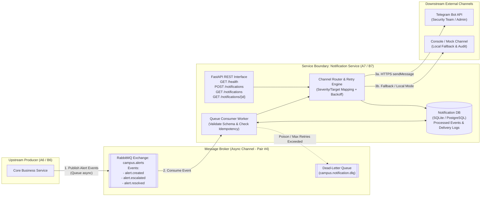

# Service Boundary — Notification Service

## 1. Thông tin nhóm & Tên Service (Context and Ownership)

- **Tên Service:** **Notification Service** (`notification-service`)
- **Tên nhóm:** Nhóm A7 — Product A *(hoặc B7 — Product B)*
- **Cặp phụ thuộc chính (theo `pairing-matrix.md`):** **Pair #4: Core Business (A6/B6) → Notification (A7/B7)**
- **Lớp:** FIT4110 – Dịch vụ kết nối và Công nghệ nền tảng
- **Thành viên nhóm:**
  1. `<Họ tên TV 1>` – `<MSSV 1>` (Service Lead)
  2. `<Họ tên TV 2>` – `<MSSV 2>` (API & Event Contract Owner)
  3. `<Họ tên TV 3>` – `<MSSV 3>` (Backend Developer)
  4. `<Họ tên TV 4>` – `<MSSV 4>` (Test & DevOps Owner)
- **Sản phẩm tổng thể của lớp:** **Smart Campus Operations Platform** (Nền tảng vận hành khuôn viên trường đại học thông minh)
- **Công nghệ dự kiến:** Python 3.11 + FastAPI, RabbitMQ (`aio-pika` cho Queue async), SQLite / PostgreSQL, `httpx` (gọi Telegram Bot API), Docker & Docker Compose.

---

## 2. Bài toán Service giải quyết (Problem Statement)

Trong hệ thống **Smart Campus Operations Platform**, khi các sự kiện bất thường xảy ra (nhiệt độ phòng vượt ngưỡng, phát hiện người lạ qua AI Vision, hoặc quẹt thẻ RFID trái phép ngoài giờ), `Core Business Service` sẽ đánh giá luật nghiệp vụ và phát sinh sự kiện cảnh báo (`alert.created`, `alert.escalated`, `alert.resolved`).

Vì việc gửi tin nhắn ra các dịch vụ bên thứ ba (như Telegram, Email, Webhook) có độ trễ mạng cao và dễ gặp lỗi tạm thời, nếu `Core Business Service` gọi đồng bộ và tự chờ gửi thông báo thì luồng xử lý nghiệp vụ trung tâm sẽ bị nghẽn. **Notification Service** giải quyết bài toán này bằng cách:
- Tiếp nhận sự kiện cảnh báo từ `Core Business Service` theo cơ chế **Queue bất đồng bộ (`Queue async` — Pair #4 trong `pairing-matrix.md`)** để tách rời (decouple) quá trình ra quyết định nghiệp vụ với quá trình chuyển phát thông báo đa kênh.
- Thực hiện định tuyến và gửi thông báo qua **Telegram Bot API** kết hợp **Console/Database Log** (làm kênh dự phòng khi môi trường lab không có kết nối ngoài).
- Đảm bảo tính tin cậy thông qua cơ chế **chống gửi trùng (idempotency theo `eventId` / `alertId`)**, xử lý sự kiện đến lệch thứ tự (out-of-order), **thử lại có kiểm soát (retry với backoff)** và chuyển sang **Dead-Letter Queue (DLQ)** khi lỗi vượt ngưỡng.
- Cung cấp thêm các endpoint **REST API** (`/health`, `/notifications`...) để kiểm tra trạng thái sống, tra cứu lịch sử chuyển phát và hỗ trợ kiểm thử trực tiếp (Postman/Newman) ở các buổi sau.

---

## 3. Actor (Các tác nhân tương tác)

| Actor / Hệ thống | Vai trò | Cơ chế giao tiếp | Mô tả tương tác với Notification Service |
|---|---|---|---|
| **Core Business Service (A6/B6)** | Upstream Partner (**Pair #4**) — Event Producer / Service Consumer | **Queue async** (RabbitMQ) *(chính)* + REST API *(dự phòng/test)* | Phát các sự kiện `alert.created`, `alert.escalated`, `alert.resolved` vào Message Queue để kích hoạt Notification Service gửi cảnh báo đa kênh. |
| **Message Broker (RabbitMQ)** | Platform Component (Trung gian truyền thông điệp) | AMQP (`Queue async`) | Nhận message từ `Core Business`, phân phối tới queue của `Notification Service` và quản lý Retry / Dead-Letter Queue (DLQ). |
| **External Notification Providers (Telegram Bot API)** | Downstream External Dependency | HTTPS REST (`POST /bot<token>/sendMessage`) | Nhận lệnh từ Notification Service để đẩy tin nhắn cảnh báo tới nhóm trực ban. |
| **Đội bảo vệ / Quản trị viên (Security Team / Campus Admin)** | End-user (Người nhận cuối) | Telegram App / Console Log | Nhận thông báo khi có cảnh báo mới (`alert.created`), leo thang (`alert.escalated`) hoặc đã xử lý xong (`alert.resolved`). |
| **API Gateway / Operations / Analytics** | Platform Component / Internal Caller | HTTP REST (`GET /health`, `GET /notifications`) | Kiểm tra trạng thái sẵn sàng của container (`GET /health`) và truy vấn lịch sử/trạng thái gửi thông báo khi cần đối soát. |

---

## 4. System Boundary & Service Boundary (Responsibility & Out of Scope)

### 4.1. System Boundary (Phạm vi trong toàn hệ thống Smart Campus)
- **Phần nhóm kiểm soát (We Own):**
  - Toàn bộ mã nguồn của **Notification Service** (cả Worker lắng nghe Queue async và tầng FastAPI REST).
  - Hợp đồng sự kiện (**Event Contract** cho Pair #4 `Core Business → Notification`) và tài liệu **OpenAPI (`openapi.yaml`)** cho các endpoint REST của Notification Service.
  - Cơ sở dữ liệu riêng (`notification_logs` / `processed_events`) để lưu vết trạng thái gửi và kiểm tra chống trùng (`idempotency`).
- **Phần nhóm chỉ tích hợp (Integrated Only):**
  - Nhận sự kiện cảnh báo từ `Core Business Service` (A6/B6) qua Message Queue theo đúng hợp đồng Pair #4 trong `pairing-matrix.md`.
  - Kết nối tới `Telegram Bot API` bên ngoài thông qua biến môi trường (`.env`), có chế độ fallback sang Console/DB Log.

### 4.2. Responsibility (Trách nhiệm của Notification Service)
1. **Tiếp nhận sự kiện cảnh báo bất đồng bộ (Queue Consumer):** Lắng nghe 3 sự kiện trọng tâm từ `Core Business Service`:
   - `alert.created`: Cảnh báo mới phát sinh → gửi thông báo khẩn theo mức `severity`.
   - `alert.escalated`: Cảnh báo chưa được xử lý, bị nâng mức độ nghiêm trọng → gửi thông báo nhắc nhở/leo thang tới cấp quản lý.
   - `alert.resolved`: Sự cố đã được giải quyết → gửi thông báo đóng cảnh báo để đội bảo vệ nắm trạng thái.
2. **Kiểm tra hợp lệ & Chống xử lý lặp (Validation & Idempotency):** Kiểm tra schema của event (`eventId`, `eventType`, `occurredAt`, `correlationId`, `data`); từ chối hoặc bỏ qua an toàn các event bị lặp (`eventId` đã xử lý thành công).
3. **Định tuyến kênh gửi (Channel Routing):** Xác định kênh gửi (`telegram`, `console`, `email/webhook` mock) dựa trên danh sách kênh yêu cầu hoặc tự động ánh xạ theo `severity` và `target` (ví dụ: `HIGH`/`CRITICAL` gửi ngay qua Telegram `security_team`).
4. **Cơ chế Retry & Dead-Letter Handling:** Khi kênh gửi bên ngoài (Telegram API) bị lỗi mạng hoặc timeout (`5xx`, `429`), thực hiện retry tối đa $N$ lần với exponential backoff; nếu vẫn thất bại thì đánh dấu `failed` và chuyển vào Dead-Letter Queue (hoặc fallback log) để không làm mất sự kiện.
5. **Ghi log trạng thái gửi (Delivery Audit Log):** Lưu lịch sử mỗi lần gửi (`notificationId`, `eventId`, `alertId`, `channel`, `status`, `retryCount`, `deliveredAt`, `errorMessage`).
6. **Cung cấp REST API quản trị & kiểm thử:** Mở endpoint `/health` cho Docker healthcheck và các endpoint REST (`/notifications`, `/notifications/{notificationId}`) để phục vụ tra cứu, kiểm thử tích hợp (Postman/Newman) và gửi thông báo trực tiếp khi cần.

### 4.3. Out of Scope (Những việc Notification Service KHÔNG làm)
- **KHÔNG** nhận dữ liệu thô trực tiếp từ cảm biến IoT (ESP32), Camera Stream hay đầu đọc thẻ Access Gate.
- **KHÔNG** chạy mô hình AI phân tích hình ảnh (`AI Vision Service`).
- **KHÔNG** đánh giá luật nghiệp vụ để quyết định khi nào tạo cảnh báo hay khi nào leo thang cảnh báo (việc sinh event `alert.created`, `alert.escalated`, `alert.resolved` thuộc trách nhiệm của `Core Business Service`).
- **KHÔNG** chịu trách nhiệm tính toán KPI tổng thể toàn trường (theo `pairing-matrix.md` Pair #8, `Core Business` đẩy trực tiếp event alert/policy sang `Analytics Service`).

---

## 5. Input / Output Contract

### 5.1. Dữ liệu đầu vào chính: Event Payload qua Queue Async (Pair #4: `Core Business → Notification`)

Theo chuẩn `docs/event-contract-template.md` và `user-stories/pair-04-core-notification-async.md`, mỗi message trên Queue có cấu trúc Envelope + Data như sau:

| Field | Type | Required | Ý nghĩa & Ràng buộc |
|---|---|---|---|
| `eventId` | `string` (UUID) | Có | Định danh duy nhất của sự kiện, dùng làm **Idempotency Key** để chống gửi trùng khi retry. |
| `eventType` | `string` (enum) | Có | Loại sự kiện: `"alert.created"`, `"alert.escalated"`, `"alert.resolved"`. |
| `occurredAt` | `string` (ISO 8601) | Có | Thời điểm `Core Business` phát sinh sự kiện (ví dụ: `"2026-05-10T08:30:00Z"`). |
| `correlationId` | `string` (UUID) | Có | Mã truy vết xuyên suốt từ sự kiện gốc (IoT/Camera/Gate → Core → Notification). |
| `source` | `string` | Có | Tên service phát sự kiện (`"core-business"`). |
| `data.alertId` | `string` | Có | Mã định danh cảnh báo (ví dụ: `"ALT-001"` hoặc UUID). |
| `data.alertType` | `string` | Có | Phân loại cảnh báo (`"UNAUTHORIZED_ACCESS"`, `"SENSOR_THRESHOLD_EXCEEDED"`, `"UNKNOWN_PERSON"`). |
| `data.severity` | `string` (enum) | Có | Mức độ nghiêm trọng: `"LOW"`, `"MEDIUM"`, `"HIGH"`, `"CRITICAL"`. |
| `data.message` | `string` | Có | Nội dung thông báo cần gửi tới người phụ trách (5–500 ký tự). |
| `data.target` | `string` | Có | Nhóm nhận mục tiêu (ví dụ: `"security_team"`, `"facility_manager"`, `"campus_admin"`). |
| `data.channels` | `array<string>` | Không | Danh sách kênh gợi ý (`["telegram", "console"]`). Nếu bỏ trống, Notification tự định tuyến theo `severity`. |

**Ví dụ JSON Event Payload (`alert.created`):**
```json
{
  "eventId": "0196fb3d-4ad7-7d1e-9f49-5d5148d2babc",
  "eventType": "alert.created",
  "occurredAt": "2026-05-10T08:30:00Z",
  "correlationId": "0196fb3d-1111-7a00-8000-000000000001",
  "source": "core-business",
  "data": {
    "alertId": "ALT-001",
    "alertType": "UNKNOWN_PERSON",
    "severity": "HIGH",
    "message": "Unknown person detected near main gate",
    "target": "security_team",
    "channels": ["telegram"]
  }
}
```

### 5.2. Dữ liệu đầu ra (Output — Kết quả xử lý & REST API Response)

**Kết quả ghi nhận chuyển phát thông báo (`NotificationDelivery`):**
```json
{
  "notificationId": "0196fb3e-9999-7d1e-9f49-5d5148d2c001",
  "eventId": "0196fb3d-4ad7-7d1e-9f49-5d5148d2babc",
  "alertId": "ALT-001",
  "eventType": "alert.created",
  "sent": true,
  "channel": "telegram",
  "target": "security_team",
  "status": "DELIVERED",
  "retryCount": 0,
  "deliveredAt": "2026-05-10T08:30:01Z",
  "errorDetail": null
}
```

**Response lỗi chuẩn cho REST API (`application/problem+json` — Problem Details):**
```json
{
  "type": "https://campus.local/errors/validation",
  "title": "Dữ liệu không hợp lệ",
  "status": 400,
  "detail": "Field severity phải thuộc một trong các giá trị: LOW, MEDIUM, HIGH, CRITICAL",
  "instance": "/notifications"
}
```

---

## 6. Provider / Consumer & Upstream / Downstream (Bảng "Ai gọi ai" theo `pairing-matrix.md`)

| Cặp # | Bên gửi / Gọi (Upstream) | Bên nhận / Xử lý (Downstream) | Cơ chế | Mục đích kết nối |
|---|---|---|---|---|
| **Pair #4 (Chính)** | `Core Business Service` (A6/B6) *(Vai Consumer nghiệp vụ / Event Producer)* | `Notification Service` (A7/B7) *(Vai Provider năng lực thông báo / Event Consumer)* | **Queue async** (RabbitMQ) | `Core Business` phát event `alert.created`, `alert.escalated`, `alert.resolved` vào Queue; `Notification Service` tiêu thụ event để gửi thông báo đa kênh. |
| **External Call** | `Notification Service` (A7/B7) | `Telegram Bot API` / Webhook | HTTPS REST (`POST`) | Gửi tin nhắn cảnh báo thực tế tới kênh Telegram của đội bảo vệ / quản trị viên. |
| **Internal / Test / Ops** | API Gateway / Postman / Admin / Analytics | `Notification Service` (A7/B7) | HTTP REST (`GET`, `POST`) | Kiểm tra `/health`, tra cứu log chuyển phát (`GET /notifications`), hoặc kích hoạt gửi thông báo qua REST (`POST /notifications`) khi test. |
| **Owned Store** | `Notification Service` (A7/B7) | `Notification DB` (SQLite / PostgreSQL) | SQL | Lưu trạng thái gửi (`DELIVERED`, `FAILED`, `DUPLICATE_IGNORED`) và khoá chống trùng `eventId`. |

---

## 7. Event dự kiến & API dự kiến (Candidate Events & REST API)

### 7.1. Event dự kiến nhận qua Queue Async (Pair #4)

| Event Name | Topic / Routing Key dự kiến | Producer | Consumer | Hành động của Notification Service |
|---|---|---|---|---|
| `alert.created` | `campus.alert.created` | `Core Business (A6/B6)` | `Notification (A7/B7)` | Kiểm tra idempotency (`eventId`), định tuyến kênh theo `severity`/`target`, gửi cảnh báo mới và lưu log. |
| `alert.escalated` | `campus.alert.escalated` | `Core Business (A6/B6)` | `Notification (A7/B7)` | Gửi thông báo leo thang khẩn cấp (kèm số lần nhắc/mức độ mới) tới nhóm phụ trách hoặc cấp quản lý. |
| `alert.resolved` | `campus.alert.resolved` | `Core Business (A6/B6)` | `Notification (A7/B7)` | Gửi thông báo xác nhận sự cố đã được xử lý xong và cập nhật trạng thái kết thúc theo `alertId`. |

### 7.2. Danh sách REST API dự kiến của Notification Service (`openapi.yaml`)

Bên cạnh Queue Consumer cho Pair #4, service cung cấp bộ REST API chuẩn OpenAPI 3.1 để phục vụ kiểm tra sức khỏe, tra cứu log và kiểm thử hợp đồng (Prism / Postman / Newman):

| Method | Endpoint | Mục đích | Caller | Status Codes chính |
|---|---|---|---|---|
| `GET` | `/health` | Kiểm tra trạng thái hoạt động của service và kết nối Queue/DB | Docker Healthcheck, Operations | `200 OK`, `503 Service Unavailable` |
| `POST` | `/notifications` | Gửi thông báo trực tiếp qua REST (dùng cho test độc lập, manual trigger hoặc HTTP fallback) | Admin, Test Runner, Core Business (fallback) | `201 Created`, `200 OK`, `400 Bad Request`, `401 Unauthorized`, `409 Conflict`, `422 Unprocessable Entity` |
| `GET` | `/notifications` | Lấy danh sách lịch sử gửi thông báo (hỗ trợ cursor-based pagination `cursor`, `limit`) | Admin, Operations, Analytics | `200 OK`, `401 Unauthorized` |
| `GET` | `/notifications/recent` | Lấy danh sách các thông báo vừa gửi gần đây | Dashboard, Operations | `200 OK`, `401 Unauthorized`, `403 Forbidden` |
| `GET` | `/notifications/{notificationId}` | Xem chi tiết trạng thái gửi, kênh gửi và số lần retry của một thông báo theo UUID | Admin, Operations | `200 OK`, `401 Unauthorized`, `404 Not Found` |

---

## 8. Hành vi khi lỗi (Failure, Retry & Degraded-Mode Behavior)

1. **Chống xử lý lặp (Idempotency):** Nếu nhận lại một message có cùng `eventId` đã ở trạng thái `DELIVERED`, Notification Service sẽ bỏ qua việc gọi lại Telegram API, ghi nhận `DUPLICATE_IGNORED` và gửi `ACK` cho Queue để tránh spam tin nhắn.
2. **Cơ chế Retry & Dead-Letter Queue (DLQ):**
   - Nếu dữ liệu sai định dạng JSON hoặc thiếu trường bắt buộc (lỗi vĩnh viễn / Poison Message): Không retry vô hạn mà từ chối message (`NACK` với `requeue=false`), đẩy thẳng sang **Dead-Letter Queue (`campus.notification.dlq`)** và ghi log lỗi.
   - Nếu gọi Telegram Bot API gặp lỗi tạm thời (timeout, mạng chập chờn, HTTP `429`/`5xx`): Thực hiện retry tối đa `MAX_RETRIES=3` lần với exponential backoff. Nếu sau 3 lần vẫn lỗi, ghi trạng thái `FAILED` vào DB và chuyển message sang DLQ (hoặc chuyển sang kênh dự phòng Console Log).
3. **Chế độ Degraded Mode trong phòng Lab:** Khi chạy trong môi trường local/container không cấu hình `TELEGRAM_BOT_TOKEN` thật, service tự động dùng `console/mock dispatcher` để ghi nhận nội dung tin nhắn và trả trạng thái `DELIVERED`, đảm bảo luồng tích hợp không bị chặn bởi dịch vụ bên ngoài.

---

## 9. Sơ đồ Service Boundary (Boundary Diagram)



---

## 10. Vấn đề cần đàm phán ở Buổi 2 (6 Issues cho Pair #4: `Core Business → Notification`)

Bám sát `docs/pairing-matrix.md` và `user-stories/pair-04-core-notification-async.md`, nhóm chuẩn bị 6 vấn đề trọng tâm để đàm phán với nhóm **Core Business (A6/B6)** ở Buổi 2:

1. **Tên Event, Topic/Routing Key và cấu trúc Envelope:** Thống nhất tên 3 sự kiện (`alert.created`, `alert.escalated`, `alert.resolved`), tên exchange/queue trên RabbitMQ và cấu trúc envelope chuẩn (`eventId`, `eventType`, `occurredAt`, `correlationId`, `source`, `data`).
2. **Bắt buộc trường `severity` và chuẩn hóa Enum:** Trả lời câu hỏi gợi ý #1 trong user story — bắt buộc `alert.created` và `alert.escalated` phải có field `severity` (`LOW | MEDIUM | HIGH | CRITICAL`) để Notification Service quyết định mức độ ưu tiên.
3. **Cơ chế định tuyến kênh gửi (`channels` vs Auto-routing):** Trả lời câu hỏi gợi ý #2 — `Core Business` sẽ truyền mảng `channels` mong muốn hay chỉ truyền `severity` + `target` (`security_team`, `facility_manager`) để `Notification Service` tự định tuyến sang kênh (Telegram/Email/Console) tương ứng.
4. **Phân định trách nhiệm Retry và Dead-Letter Queue (DLQ):** Trả lời câu hỏi gợi ý #3 — khi gửi Telegram thất bại tạm thời, `Notification Service` tự retry nội bộ (ví dụ tối đa 3 lần với backoff) hay dùng cơ chế retry/requeue của Message Queue và khi nào thì đẩy vào DLQ.
5. **Chống gửi trùng (Idempotency) khi Queue giao lặp (At-least-once delivery):** Thống nhất `Core Business` gắn `eventId` (UUID duy nhất cho mỗi lần phát sự kiện) và `alertId` (mã cảnh báo nghiệp vụ) để `Notification Service` lọc trùng, đảm bảo không gửi lặp tin nhắn cho cùng một `eventId`.
6. **Xử lý sự kiện đến sai thứ tự (Out-of-order events):** Thống nhất cách xử lý dựa trên `occurredAt` khi event `alert.resolved` đến trước hoặc gần như đồng thời với `alert.created` / `alert.escalated` của cùng một `alertId`.
