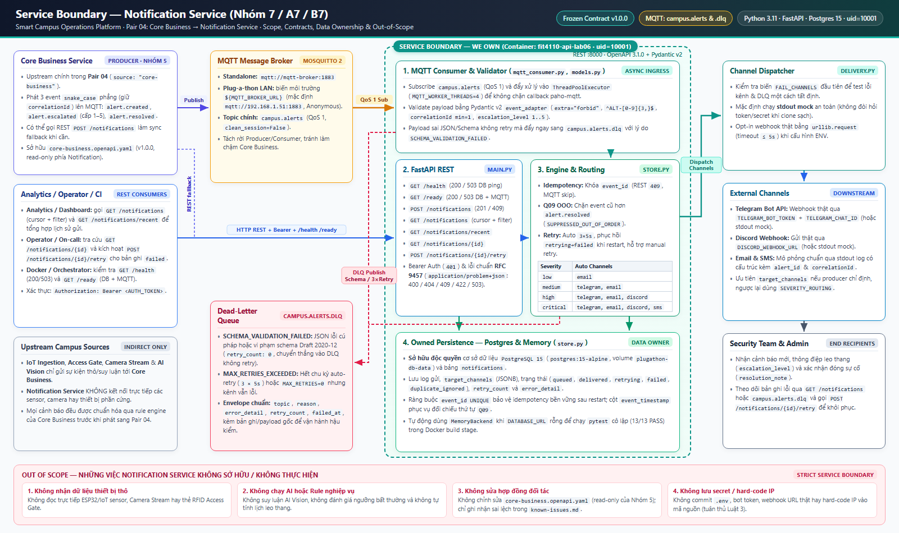
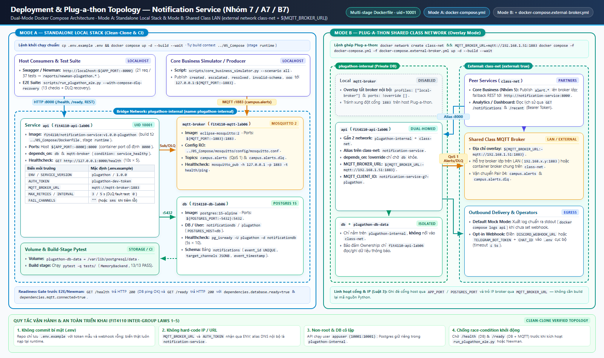

# FIT4110 Lab 06 — Plug-a-thon & Demo Pack: Notification Service (Nhóm 6)

| Thông tin dự án        | Giá trị                                                                                     |
| :--------------------- | :------------------------------------------------------------------------------------------ |
| **Môn học**            | FIT4110 — Dịch vụ kết nối và Công nghệ nền tảng                                             |
| **Đồ án**              | **Smart Campus Operations Platform**                                                        |
| **Dịch vụ**            | **Notification Service** (`notification-service`)                                           |
| **Nhóm / Sinh viên**   | **Nhóm 6 _(hoặc A7 / B7)_** · **Nguyễn Minh Phượng** (`<MãSinhViên>`)                       |
| **Cặp tích hợp chính** | **Pair 04:** Core Business (`Nhóm 5 / A6 / B6`) → Notification Service (`Nhóm 6 / A7 / B7`) |
| **Phiên bản hợp đồng** | `v1.0.0` (OpenAPI 3.1.0 & Pair-04 JSON Schema Draft 2020-12 — **Frozen**)                   |

---

## 1. Tổng quan Dịch vụ & Vai trò trong Smart Campus Platform

**Notification Service** là dịch vụ thông báo đa kênh, chạy bất đồng bộ qua MQTT kết hợp REST API dự phòng, chịu trách nhiệm tiếp nhận cảnh báo chuẩn hóa từ **Core Business** (`alert.created`, `alert.escalated`, `alert.resolved`), kiểm tra hợp lệ hợp đồng, khử trùng lặp (`Q05`), chống thông điệp đến muộn (`Q09`), tự động định tuyến kênh gửi (`low` → `critical`), tự động retry + đẩy Dead-Letter Queue (`campus.alerts.dlq`) và lưu nhật ký gửi bền vững trong PostgreSQL riêng.

---

## 2. Service Boundary & Luồng Dữ Liệu



- **Bên trong ranh giới (`WE OWN`):** FastAPI REST (`main.py`), MQTT Consumer & Validator (`mqtt_consumer.py`, `models.py` dùng `ThreadPoolExecutor` = 4 luồng), Engine Idempotency / Routing / Q09 / Retry (`store.py`), PostgreSQL 15 riêng (`fit4110-db-lab06`, volume `plugathon-db-data`), Channel Dispatcher (`delivery.py`).
- **Ngoài ranh giới (`OUT OF SCOPE`):** Không kết nối trực tiếp cảm biến IoT/Camera/Access Gate; không chạy AI hay rule ngưỡng nghiệp vụ; không sửa file hợp đồng của đối tác (`contracts/core-business.openapi.yaml` read-only); không lưu secret hoặc hard-code IP trong mã nguồn.
- Tài liệu chi tiết: [docs/service_boundary.md](docs/service_boundary.md) · [docs/architecture_one_pager.md](docs/architecture_one_pager.md).

---

## 3. Hợp đồng Đóng băng (`Frozen Contracts v1.0.0`)

Toàn bộ **9 tệp hợp đồng** của Lab 06 được đóng băng nguyên vẹn tại [contracts/](contracts/notification.openapi.yaml) và kiểm tra đối chiếu **SHA-256** theo byte với nguồn chuẩn ở Lab 03 và Lab 05 bằng `scripts/verify_frozen_contracts.py`:

| Nhóm hợp đồng                   | Tệp đóng băng                                                                                                                                                                                                      | Vai trò                                                                             |
| :------------------------------ | :----------------------------------------------------------------------------------------------------------------------------------------------------------------------------------------------------------------- | :---------------------------------------------------------------------------------- |
| **REST OpenAPI (We Own)**       | [contracts/notification.openapi.yaml](contracts/notification.openapi.yaml)                                                                                                                                         | Đặc tả `v1.0.0` (OpenAPI 3.1.0, BearerAuth, RFC 9457, cursor pagination)            |
| **Partner OpenAPI (Read-Only)** | [contracts/core-business.openapi.yaml](contracts/core-business.openapi.yaml)                                                                                                                                       | Hợp đồng `v1.0.0` phía Core Business (Nhóm 5)                                       |
| **Event & Queue Contract**      | [contracts/event-contract.md](contracts/event-contract.md), [contracts/producer-consumer-handshake.md](contracts/producer-consumer-handshake.md), [contracts/event-test-matrix.md](contracts/event-test-matrix.md) | Quy ước Pair 04 (`campus.alerts`, `campus.alerts.dlq`, `Q01`–`Q09`)                 |
| **JSON Schemas Draft 2020-12**  | `contracts/schema/{alert.created,alert.escalated,alert.resolved,campus.alerts}.schema.json`                                                                                                                        | Ràng buộc `additionalProperties: false`, `^ALT-[0-9]{3,}$`, `escalation_level 1..5` |

### Danh mục Endpoint & Ma trận Định tuyến (`SEVERITY_ROUTING`)

| Endpoint                                      | Xác thực | Mã trả về chính                       | Mô tả                                                                 |
| :-------------------------------------------- | :------: | :------------------------------------ | :-------------------------------------------------------------------- |
| `GET /health`                                 |  Không   | `200` / `503`                         | Liveness + kiểm tra `SELECT 1` trên PostgreSQL                        |
| `GET /ready`                                  |  Không   | `200` / `503`                         | Readiness (`database.ready` và `mqtt.connected`)                      |
| `POST /notifications`                         |  Bearer  | `201` / `400` / `401` / `409` / `422` | Tiếp nhận đồng bộ sự kiện Pair 04 + chống trùng `event_id` (`409`)    |
| `GET /notifications`                          |  Bearer  | `200` / `400` / `401` / `422`         | Danh sách log phân trang cursor + lọc `alert_id`, `status`, `channel` |
| `GET /notifications/recent`                   |  Bearer  | `200` / `400` / `401` / `422`         | Danh sách gần nhất (`limit` `1..100`; `limit=101` → `400`)            |
| `GET /notifications/{notification_id}`        |  Bearer  | `200` / `401` / `404`                 | Chi tiết 1 bản ghi thông báo (`notif-...`)                            |
| `POST /notifications/{notification_id}/retry` |  Bearer  | `200` / `401` / `404`                 | Manual retry cho bản ghi lỗi, tăng `retry_count`                      |

- **Định tuyến mặc định khi vắng `target_channels`:** `low → [email]`, `medium → [telegram, email]`, `high → [telegram, email, discord]`, `critical → [telegram, email, discord, sms]` (chi tiết xem [docs/endpoint_catalog.md](docs/endpoint_catalog.md)).

---

## 4. Kiến trúc Triển khai & Chạy nhanh (`Docker Compose Dual-Mode`)



1. **Chuẩn bị từ Clean Clone:**
   ```bash
   cd FIT4110_MSSV/06_Plugathon
   cp .env.example .env                 # PowerShell: Copy-Item .env.example .env
   npm ci
   python scripts/verify_frozen_contracts.py
   npm run lint:openapi
   ```
2. **Chế độ A — Standalone Stack (`docker-compose.yml`):**
   ```bash
   docker compose up -d --build --wait
   python scripts/core_business_simulator.py --scenario all
   python scripts/run_plugathon_e2e.py --with-compose-dlq-recovery
   npm run test:plugathon
   ```
3. **Chế độ B — Plug-a-thon Mạng Chung (`class-net` + External Broker):**
   ```bash
   docker network create class-net
   MQTT_BROKER_URL=mqtt://192.168.1.51:1883 \
     docker compose -f docker-compose.yml -f docker-compose.external-broker.yml up -d --build --wait
   ```

Chi tiết tham số, cổng và xử lý sự cố xem tại [RUN_PLUGATHON.md](RUN_PLUGATHON.md) và [docs/integration_notes.md](docs/integration_notes.md).

---

## 5. Khả năng Chịu lỗi & Tự động Tiêm lỗi (`DLQ`, `Q09`, `Retry`)

- **Schema Validation Failed (`Q08`):** Payload JSON lỗi cú pháp hoặc vi phạm Draft 2020-12 → `retry_count=0`, đẩy thẳng sang **`campus.alerts.dlq`** (`reason: SCHEMA_VALIDATION_FAILED`).
- **Auto-Retry & Max Retries Exceeded (`Q07`):** Khi kênh thuộc `FAIL_CHANNELS` hoặc lỗi kết nối, tự động retry (`MAX_RETRIES=3`, `RETRY_INTERVAL_SECONDS=5`), kẹt `retrying` lúc restart tự chuyển `failed`; quá hạn đẩy sang **`campus.alerts.dlq`** (`reason: MAX_RETRIES_EXCEEDED`).
- **Out-of-Order Suppression (`Q09`):** `alert.created` trễ hơn `alert.resolved` của cùng `alert_id` bị chặn với `status=duplicate_ignored`, `error_detail=SUPPRESSED_OUT_OF_ORDER:...`.
- **Manual Recovery:** Khôi phục lỗi kênh rồi gọi `POST /notifications/{notification_id}/retry` đưa bản ghi từ `failed` về `delivered`. Xem quy trình đầy đủ tại [docs/fault_injection_runbook.md](docs/fault_injection_runbook.md).

---

## 6. Bằng chứng Kiểm thử & Kết quả Chạy

| Hạng mục kiểm chứng          | Lệnh thực thi                                                     | Quy mô thiết kế                | Trạng thái cập nhật                                                                                  |
| :--------------------------- | :---------------------------------------------------------------- | :----------------------------- | :--------------------------------------------------------------------------------------------------- |
| **Frozen Contracts Parity**  | `python scripts/verify_frozen_contracts.py`                       | 9/9 tệp SHA-256                | Đã xác minh (`9/9` khớp byte)                                                                        |
| **OpenAPI Spectral Lint**    | `npm run lint:openapi`                                            | OpenAPI 3.1.0                  | Đã xác minh (`0` errors)                                                                             |
| **Compose Validation**       | `make config`                                                     | Standalone + External overlay  | Đã xác minh (`exit 0`)                                                                               |
| **Unit Tests (build stage)** | `pytest -q tests/` (trong `../05_Compose`)                        | 13 tests (`MemoryBackend`)     | Đạt 13/13 từ Lab 05                                                                                  |
| **Plug-a-thon E2E & DLQ**    | `python scripts/run_plugathon_e2e.py --with-compose-dlq-recovery` | 13 kịch bản E2E + tiêm lỗi DLQ | _Chờ `@plugathon-verifier` chạy & ghi nhận tại [evidence/fault_record.md](evidence/fault_record.md)_ |
| **Newman Suite**             | `npm run test:plugathon`                                          | 21 requests / 37 `pm.test`     | _Chờ `@plugathon-verifier` chạy & xuất `reports/newman-plugathon.{html,xml}`_                        |

- **Vị trí bằng chứng & báo cáo (do `@plugathon-verifier` tổng hợp sau lượt chạy thực tế):**
  - Nhật ký container & chạy test: `evidence/logs/`
  - Ảnh chụp kiểm chứng (`swagger-ui.png`, `newman-report.png`, `ready-endpoint.png`): `evidence/screenshots/`
  - Nhật ký tiêm lỗi & phục hồi: `evidence/fault_record.md`
  - Báo cáo Newman HTML/JUnit: `reports/newman-plugathon.html`, `reports/newman-plugathon.xml`

---

## 7. Tài liệu Kiến trúc, Slide Trình bày & Demo Pack

- **Tài liệu kỹ thuật (`docs/`):** [service_boundary.md](docs/service_boundary.md) · [endpoint_catalog.md](docs/endpoint_catalog.md) · [architecture_one_pager.md](docs/architecture_one_pager.md) · [integration_notes.md](docs/integration_notes.md) · [fault_injection_runbook.md](docs/fault_injection_runbook.md) · [changelog.md](docs/changelog.md)
- **Slide thuyết trình:** [slides/architecture_presentation.html](slides/architecture_presentation.html) · [slides/architecture_presentation.pdf](slides/architecture_presentation.pdf)
- **Demo Pack toàn repo:** [../demo/video_script_2_3min.md](../demo/video_script_2_3min.md) · [../demo/run_demo.sh](../demo/run_demo.sh) · [../demo/run_demo.ps1](../demo/run_demo.ps1) · [evidence/demo_video_link.txt](evidence/demo_video_link.txt)
- **Quản trị, Đóng góp & Rà soát:** [known-issues.md](known-issues.md) · [CONTRIBUTION.md](CONTRIBUTION.md) · [evidence/reflection/individual_reflection.md](evidence/reflection/individual_reflection.md) · [checklists/plugathon_checklist.md](checklists/plugathon_checklist.md) · [checklists/submission_checklist.md](checklists/submission_checklist.md)
