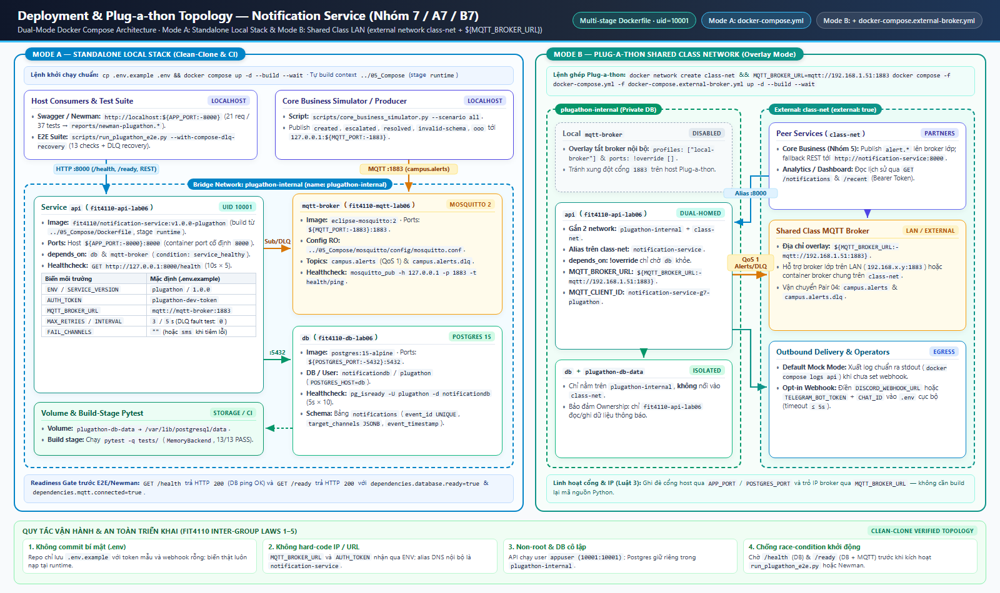

# Architecture One-Pager — Notification Service (Nhóm 6 / A7 / B7)

| Trường | Thông tin |
| :--- | :--- |
| **Dịch vụ** | **Notification Service** (`notification-service`) — Smart Campus Operations Platform |
| **Chủ sở hữu** | **Nhóm 6 *(hoặc A7 / B7)*** · Sinh viên: **Nguyễn Minh Phượng** (`<MãSinhViên>`) |
| **Cặp tích hợp** | **Pair 04:** Core Business (`Nhóm 5 / A6 / B6`) → Notification Service (`Nhóm 6 / A7 / B7`) |
| **Stack cốt lõi** | Python 3.11 · FastAPI · Pydantic v2 · PostgreSQL 15 · Eclipse Mosquitto 2 (`paho-mqtt`) · Docker Compose (non-root `uid=10001`) |

---

## 1. Vấn đề & Sứ mệnh Thiết kế

Trong hệ thống giám sát trường học thông minh, khi có sự cố an ninh/hạ tầng (`alert.created`, `alert.escalated`, `alert.resolved`), Core Business cần phát cảnh báo nhanh mà **không bị nghẽn** bởi thời gian chờ các cổng gửi ngoài (Telegram, Discord, Email, SMS), đồng thời không làm mất sự kiện khi kênh ngoài gặp sự cố tạm thời hay sự kiện đến sai thứ tự qua mạng.

**Notification Service** đảm nhận vai trò tiêu thụ bất đồng bộ Pair 04 (kèm REST fallback), chuẩn hóa kiểm tra hợp đồng ở tầng rìa, lưu vết bền vững trong PostgreSQL riêng, chống trùng lặp/lệch thứ tự (`Q05`, `Q09`), tự động retry + đẩy DLQ và hỗ trợ operator khôi phục bằng tay.

---

## 2. Kiến trúc nội bộ & Luồng dữ liệu

```
Core Business (Nhóm 5) ──MQTT QoS 1 (campus.alerts)──▶ MqttConsumer (paho-mqtt + ThreadPoolExecutor=4)
       │                                                       │
       │ (Sync Fallback REST POST /notifications)              ▼ Pydantic v2 (extra="forbid")
       └──────────────────────────────────────────────▶ NotificationStore (Engine + PostgreSQL 15)
                                                           │        │                │
       Analytics / Operator ◀──GET / POST /retry───────────┘        │                ▼ Bad JSON / Max Retry
                                                                    ▼          campus.alerts.dlq
                                                            ChannelDispatcher
                                                    (FAIL_CHANNELS -> Mock/Webhook <=5s)
```

1. **Async Ingress (`mqtt_consumer.py`, `models.py`):** Subscribe `campus.alerts` (QoS 1, `clean_session=False`), đẩy mỗi thông điệp vào `ThreadPoolExecutor` (`MQTT_WORKER_THREADS=4`) để tránh block callback mạng. Nếu JSON hỏng hoặc sai schema Draft 2020-12 → chuyển thẳng sang `campus.alerts.dlq` (`SCHEMA_VALIDATION_FAILED`, `retry_count=0`).
2. **Engine & Persistence (`store.py`):**
   - **Idempotency bền vững:** Cột `event_id UNIQUE` trong PostgreSQL bảo đảm replay hoặc duplicate MQTT (`Q05`) chỉ tạo đúng 1 bản ghi; REST trùng trả `409 Conflict`.
   - **Out-of-Order Guard (`Q09`):** Cột `event_timestamp` đối chiếu với các bản ghi `alert.resolved` đã xử lý; sự kiện `alert.created`/`alert.escalated` cũ hơn mốc đóng sự cố bị chuyển thành `duplicate_ignored` (`SUPPRESSED_OUT_OF_ORDER:...`).
   - **Routing & Auto-Retry:** Nếu payload không chỉ định `target_channels`, dùng `SEVERITY_ROUTING` (`low: [email]`, `medium: [telegram, email]`, `high: [telegram, email, discord]`, `critical: [telegram, email, discord, sms]`). Lỗi kênh tự retry `MAX_RETRIES=3` lần cách nhau `RETRY_INTERVAL_SECONDS=5s` (tạo bản ghi `retrying` → `failed` nếu kẹt lúc restart), quá hạn đẩy `campus.alerts.dlq` (`MAX_RETRIES_EXCEEDED`).
3. **Channel Dispatcher (`delivery.py`):** Kiểm tra `FAIL_CHANNELS` trước tiên để tiêm lỗi xác định; mặc định phát log cấu trúc an toàn ra stdout, và kích hoạt `urllib.request` HTTPS (timeout `<= 5.0s`) khi operator nạp `DISCORD_WEBHOOK_URL` hoặc `TELEGRAM_BOT_TOKEN` + `TELEGRAM_CHAT_ID`.

---

## 3. Chiến lược Triển khai (Dual-Mode Compose)



| Chế độ | Lệnh khởi chạy | Mục đích & Kết nối |
| :--- | :--- | :--- |
| **Mode A — Standalone Local** | `docker compose up -d --build --wait` | Chạy khép kín 3 container trên bridge `plugathon-internal`: `fit4110-api-lab06` (`:8000`), `fit4110-db-lab06` (`:5432`), `fit4110-mqtt-lab06` (`:1883`). Lý tưởng cho clean-clone và CI. |
| **Mode B — Plug-a-thon `class-net`** | `docker compose -f docker-compose.yml -f docker-compose.external-broker.yml up -d --build --wait` | Tắt Mosquitto nội bộ (`profiles: ["local-broker"]`), giữ Postgres riêng trong `plugathon-internal`, nối container API vào `class-net` với alias `notification-service` và trỏ tới `${MQTT_BROKER_URL:-mqtt://192.168.1.51:1883}`. |

---

## 4. Hợp đồng & Chỉ tiêu Chất lượng (Quality Gates)

- **Contract Governance:** `python scripts/verify_frozen_contracts.py` đối chiếu SHA-256 `9/9` tệp trong `contracts/`; `npm run lint:openapi` kiểm tra OpenAPI 3.1.0 bằng Spectral (`0` errors).
- **Automated Verification Suites:**
  - **Unit test (build stage):** `pytest -q tests/` (`MemoryBackend`, `13/13` cases ở Lab 05).
  - **Plug-a-thon E2E Harness:** `python scripts/run_plugathon_e2e.py --with-compose-dlq-recovery` kiểm tra `13` kịch bản end-to-end gồm probes, MQTT lifecycle, `Q05`, `Q09`, DLQ `SCHEMA_VALIDATION_FAILED`, lỗi `409`/`401`/`422`, tiêm lỗi `FAIL_CHANNELS=sms` → DLQ `MAX_RETRIES_EXCEEDED` → phục hồi `/retry`.
  - **Postman / Newman Suite:** `npm run test:plugathon` chạy collection **21 requests / 37 `pm.test` assertions** và xuất báo cáo HTML/JUnit ra `reports/`.
- **Security & Portability (Luật 3):** Container chạy user không quyền root `appuser` (`uid=10001:10001`); zero secrets trong Git; không hard-code IP đối tác.

