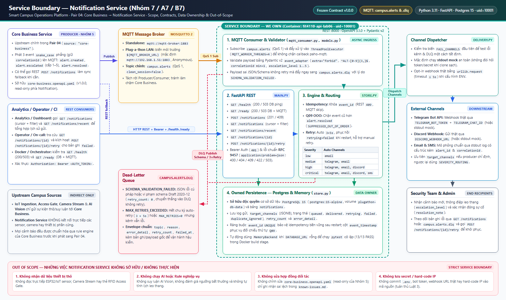

# Service Boundary — Notification Service (Nhóm 6 / A7 / B7)

Tài liệu ranh giới dịch vụ chuẩn hóa cho **Lab 06 Plug-a-thon** (cập nhật từ baseline [01_Setup/evidence/buoi-01/service-boundary.md](../../01_Setup/evidence/buoi-01/service-boundary.md) sau quá trình thương lượng OpenAPI Lab 02, chốt schema Draft 2020-12 Lab 03 và triển khai Postgres + Mosquitto Lab 05).

---

## 1. Định danh & Vai trò trong Smart Campus Operations Platform

| Thuộc tính | Giá trị chuẩn hóa (Lab 06) |
| :--- | :--- |
| **Tên dịch vụ** | Notification Service (`notification-service`) |
| **Nhóm phụ trách** | **Nhóm 6 *(hoặc A7 / B7)*** |
| **Cặp tích hợp chính** | **Pair 04:** Core Business (`Nhóm 5 / A6 / B6`) → Notification Service (`Nhóm 6 / A7 / B7`) |
| **Runtime & Container** | Python 3.11 + FastAPI + Pydantic v2 + PostgreSQL 15 (`fit4110-db-lab06`) + Mosquitto 2 (`fit4110-mqtt-lab06`), container API `fit4110-api-lab06` chạy non-root `uid=10001 (appuser)` |
| **Phiên bản hợp đồng** | `notification.openapi.yaml` `v1.0.0` (OpenAPI 3.1.0) & Pair 04 JSON Schema Draft 2020-12 (`frozen`) |

---

## 2. Quyền sở hữu dữ liệu & Thành phần nội bộ (WE OWN)

Notification Service sở hữu **độc quyền** dữ liệu trạng thái thông báo và toàn bộ thành phần trong ranh giới sau:

1. **MQTT Consumer & Validator (`mqtt_consumer.py`, `models.py`):**
   - Subscribe topic `campus.alerts` với **QoS 1** và `clean_session=False`, client ID mặc định `notification-service-g6` (hoặc `notification-service-g6-plugathon` khi chạy overlay external broker).
   - Xử lý message bằng `ThreadPoolExecutor` (`MQTT_WORKER_THREADS=4`) tách khỏi network loop của `paho-mqtt`.
   - Validate payload bằng Pydantic v2 `event_adapter` (`extra="forbid"`, `alert_id` khớp `^ALT-[0-9]{3,}$`, `correlationId minLength=1`, `escalation_level` `1..5`). Payload lỗi JSON hoặc sai schema không retry mà đẩy thẳng sang `campus.alerts.dlq` với lý do `SCHEMA_VALIDATION_FAILED`.
2. **FastAPI REST Gateway (`main.py`):**
   - Công bố 7 endpoints tại cổng container `8000` (xem chi tiết tại [endpoint_catalog.md](endpoint_catalog.md)): `/health`, `/ready`, `POST /notifications`, `GET /notifications`, `GET /notifications/recent`, `GET /notifications/{notification_id}`, `POST /notifications/{notification_id}/retry`.
   - Bảo vệ các route `/notifications*` bằng `Authorization: Bearer <AUTH_TOKEN>` (`401` khi thiếu/sai token) và chuẩn hóa mọi lỗi 4xx/5xx theo **RFC 9457** (`application/problem+json`).
3. **Engine Idempotency, Thứ tự & Định tuyến (`store.py`):**
   - **Idempotency theo `event_id`:** Trùng qua REST trả `409 Conflict`; trùng qua MQTT bỏ qua an toàn (`skipped_duplicate`), không gửi lặp ra kênh ngoài.
   - **Chống sự cố đến muộn (`Q09 Out-of-Order`):** Nếu `alert_id` đã từng xử lý một `alert.resolved` có `event_timestamp` mới hơn event vừa đến, bản ghi được lưu với `status=duplicate_ignored`, `error_detail=SUPPRESSED_OUT_OF_ORDER:...` và bị chặn gửi.
   - **Định tuyến kênh (`SEVERITY_ROUTING`):** Ưu tiên danh sách `target_channels` nếu producer truyền tường minh; ngược lại tự động chọn theo `severity`:
     - `low` → `["email"]`
     - `medium` → `["telegram", "email"]`
     - `high` → `["telegram", "email", "discord"]`
     - `critical` → `["telegram", "email", "discord", "sms"]`
   - **Retry & Recovery:** Tự động thử lại tối đa `MAX_RETRIES` lần (mặc định `3`), giãn cách `RETRY_INTERVAL_SECONDS` giây (mặc định `5s`); khi container khởi động lại (`init()`), các bản ghi kẹt ở `retrying` được đưa về `failed` để operator có thể gọi `/retry`.
4. **PostgreSQL Persistence (`PostgreSQL 15`, `store.py`):**
   - Cơ sở dữ liệu riêng `notificationdb` trên container `fit4110-db-lab06` (`postgres:15-alpine`, volume `plugathon-db-data`), bảng `notifications` với khóa duy nhất `event_id UNIQUE`, `target_channels JSONB`, `event_timestamp` và index phục vụ lọc theo `alert_id`, `status`, `created_at`.
   - Khi `DATABASE_URL` rỗng (bước `pytest` trong Docker build stage), tự động chuyển sang `MemoryBackend` cô lập (`13/13` unit tests).
5. **Channel Dispatcher (`delivery.py`):**
   - Kiểm tra biến `FAIL_CHANNELS` đầu tiên nhằm mô phỏng lỗi từng kênh (`sms`, `discord`, `telegram`, `email`) phục vụ test DLQ tất định.
   - Mặc định phát qua **stdout mock có cấu trúc** (zero-secret clean clone); tự động gọi webhook HTTPS (`urllib.request`, timeout bị chặn `<= 5.0s`) khi có `DISCORD_WEBHOOK_URL` hoặc `TELEGRAM_BOT_TOKEN` + `TELEGRAM_CHAT_ID`.

---

## 3. Giao tiếp Bất đồng bộ (MQTT Contracts) & Đồng bộ (REST Consumers)

| Hướng kết nối | Đối tác / Thành phần | Kênh / Giao thức | Hợp đồng tham chiếu |
| :--- | :--- | :--- | :--- |
| **Upstream Producer (chính)** | Core Business (`Nhóm 5 / A6 / B6`) | MQTT topic `campus.alerts` (QoS 1); có thể gọi `POST /notifications` khi cần fallback đồng bộ | [event-contract.md](../contracts/event-contract.md), [schema/](../contracts/schema/campus.alerts.schema.json) |
| **Dead-Letter Sink** | Operator / Monitoring / CI | MQTT topic `campus.alerts.dlq` (QoS 1), envelope gồm `topic`, `reason`, `error_detail`, `retry_count`, `failed_at`, payload/record | [event-test-matrix.md](../contracts/event-test-matrix.md) |
| **REST Consumers** | Analytics / Dashboard (`GET`), On-call Operator (`GET` + `/retry`), Docker / CI (`/health`, `/ready`) | HTTP REST `:8000` + Bearer Token (trừ probes) | [notification.openapi.yaml](../contracts/notification.openapi.yaml) |
| **Downstream Delivery** | Security Team & Campus Admin qua Telegram, Discord, Email, SMS | Outbound HTTPS webhook (opt-in) hoặc structured stdout mock | [architecture_one_pager.md](architecture_one_pager.md) |

---

## 4. Out of Scope — Những việc Notification Service KHÔNG sở hữu

1. **Không kết nối trực tiếp phần cứng hoặc luồng thô:** Không nhận dữ liệu từ ESP32/IoT sensor, Access Gate RFID hay Camera Stream; mọi sự kiện thô chỉ đi vào Core Business / AI Vision rồi mới qua Pair 04.
2. **Không chạy suy luận AI hoặc Rule Engine nghiệp vụ:** Không đánh giá ngưỡng nhiệt độ/khói, không tính toán cấp độ leo thang hay phát hiện xâm nhập; chỉ thực thi định tuyến và gửi theo payload hợp lệ đã chuẩn hóa từ Core Business.
3. **Không chỉnh sửa hợp đồng sở hữu bởi nhóm khác:** `contracts/core-business.openapi.yaml` thuộc quyền Nhóm 5 (chỉ đọc phía Nhóm 6). Mọi điểm lệch ví dụ phát hiện được chỉ ghi vào [known-issues.md](../known-issues.md).
4. **Không lưu secret thật hay hard-code IP:** Tuân thủ Luật 3 — mọi token/URL/broker đi qua biến môi trường (`.env` cục bộ không commit) và tham số runtime.

---

## 5. Điểm đã cập nhật so với thiết kế nháp Lab 01

- **Cập nhật routing `high`:** Từ `[telegram, email]` (bản nháp Lab 01) thành `[telegram, email, discord]` theo Issue #7 Lab 02 và `event-contract.md` Lab 03.
- **Chuẩn hóa mã lỗi validation:** Thống nhất `422 Unprocessable Entity` (RFC 9457) cho Pydantic schema validation lỗi trên body và `400 Bad Request` cho query constraint hoặc malformed JSON (`limit=101`, JSON hỏng), thay vì dùng chung `400`.
- **Cập nhật schema mở rộng:** Bổ sung khả năng nhận các trường optional `severity`, `message`, `target_channels` trong `alert.escalated` và `target_channels` trong `alert.resolved`.

