# Notification Service, Smart Campus Operations Platform

Môn học: `FIT4110`, Dịch vụ kết nối và Công nghệ nền tảng  
Giảng viên hướng dẫn: ThS. Nguyễn Văn Nhân  
Phân hệ: Notification Service (`notification-service`, Nhóm 7 / A7 / B7), cặp tích hợp Pair 04 từ `Core Business` (Nhóm 5) sang `Notification Service` (Nhóm 7)  
Repository: [1677030156NguyenMinhPhuongKHMT17-01/DichVuKetNoiVaCongNgheNenTang_1677030156](https://github.com/1677030156NguyenMinhPhuongKHMT17-01/DichVuKetNoiVaCongNgheNenTang_1677030156.git)

## Phân công công việc nhóm (Lab 01 đến Lab 06)

| STT | Mã sinh viên | Họ và tên | Lớp | Phạm vi phụ trách | Tỷ lệ |
| :---: | :---: | :--- | :---: | :--- | :---: |
| 1 | 1677030156 | Nguyễn Minh Phượng (Trưởng nhóm) | KHMT 17-01 | Thiết kế OpenAPI 3.1 và Event Contract Pair 04, cài đặt FastAPI, MQTT Consumer, PostgreSQL/DLQ, giao diện Demo Control Center, Docker/Compose và tích hợp Plug-a-thon | 75% |
| 2 | 1771040019 | Hoàng Minh Quân | KHMT 17-01 | Kiểm thử Postman/Newman, Queue Contract Test (Ajv Q05 đến Q09), kịch bản tiêm lỗi (Fault Injection), kiểm thử giao diện Demo và thu thập minh chứng | 25% |

Biên bản đóng góp từng buổi nằm tại [`06_Plugathon/CONTRIBUTION.md`](./06_Plugathon/CONTRIBUTION.md), [`05_Compose/CONTRIBUTION.md`](./05_Compose/CONTRIBUTION.md), [`04_Docker/CONTRIBUTION.md`](./04_Docker/CONTRIBUTION.md), [`03_Postman/CONTRIBUTION.md`](./03_Postman/CONTRIBUTION.md), [`02_OpenAPI/CONTRIBUTION.md`](./02_OpenAPI/CONTRIBUTION.md) và [`01_Setup/CONTRIBUTION.md`](./01_Setup/CONTRIBUTION.md).

## 1. Tổng quan về Notification Service

Notification Service nhận cảnh báo từ Core Business Service (Nhóm 5), chuyển phát ra các kênh ngoài và lưu lịch sử giao tin, tách riêng khỏi luồng xử lý luật nghiệp vụ của Core Business.

Dịch vụ thực hiện các công việc sau:

- Lắng nghe topic MQTT `campus.alerts` (`QoS 1`, `clean_session=False`) để nhận ba sự kiện `alert.created`, `alert.escalated` và `alert.resolved` theo hợp đồng Pair 04.
- Gửi thông báo qua `telegram`, `email`, `discord` và `sms`. Nếu sự kiện có sẵn `target_channels`, dịch vụ dùng đúng danh sách đó; nếu bỏ trống, dịch vụ tự chọn kênh theo `severity` (`low` gửi `email`; `medium` gửi `telegram, email`; `high` gửi `telegram, email, discord`; `critical` gửi đủ bốn kênh).
- Chống gửi trùng theo cột `event_id UNIQUE` trong PostgreSQL (quy tắc `Q05`) và bỏ qua các `alert.created` đến sau khi sự cố đã có `alert.resolved` (quy tắc `Q09`, ghi `SUPPRESSED_OUT_OF_ORDER`).
- Tự động thử lại khi kênh gửi gặp lỗi (`MAX_RETRIES=3`, cách nhau `RETRY_INTERVAL_SECONDS=5`), đẩy các bản ghi sai schema (`SCHEMA_VALIDATION_FAILED`) hoặc hết lượt thử lại (`MAX_RETRIES_EXCEEDED`) sang topic `campus.alerts.dlq`, và cung cấp API `POST /notifications/{id}/retry` để gửi lại thủ công.
- Cung cấp 7 REST endpoint chuẩn OpenAPI 3.1.0 (`v1.0.0`, lỗi theo RFC 9457 `application/problem+json`) làm đường dự phòng cho Core Business và phục vụ tra cứu nhật ký phân trang cursor.
- Kèm giao diện Web Demo Control Center 5 tab tại `/` và `/demo` trên cổng `:8000` để bật kịch bản kiểm thử và tiêm lỗi trực tiếp khi chạy demo. Các route demo dùng `include_in_schema=False` nên tài liệu OpenAPI gốc không thay đổi.
- Ngoài phạm vi xử lý: dịch vụ không kết nối trực tiếp cảm biến IoT, camera, cổng kiểm soát vào ra, không chạy mô hình AI và không tự sinh luật cảnh báo.

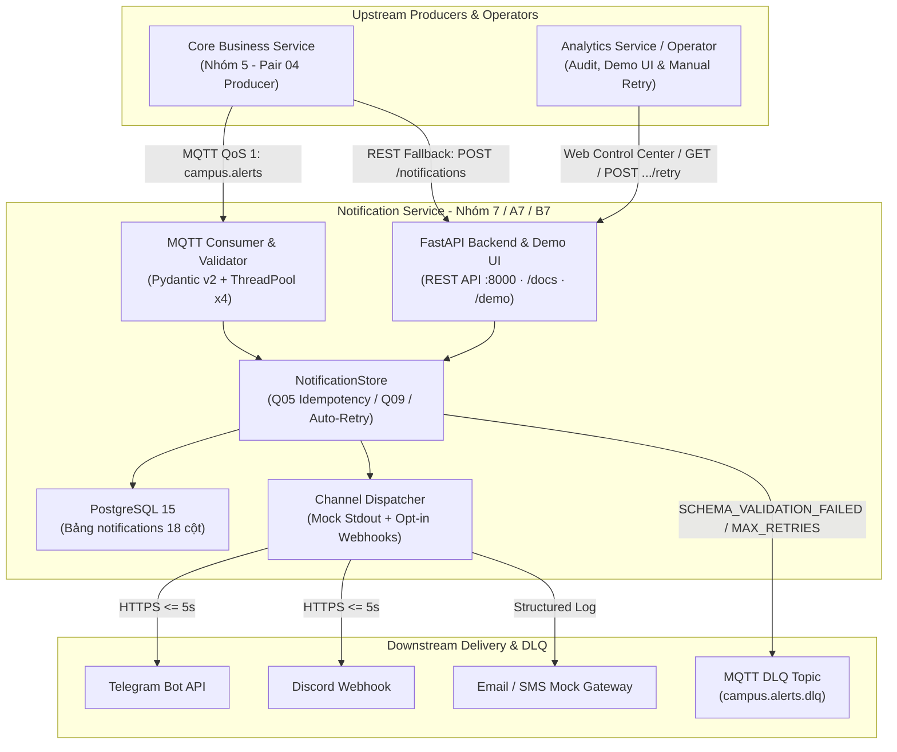

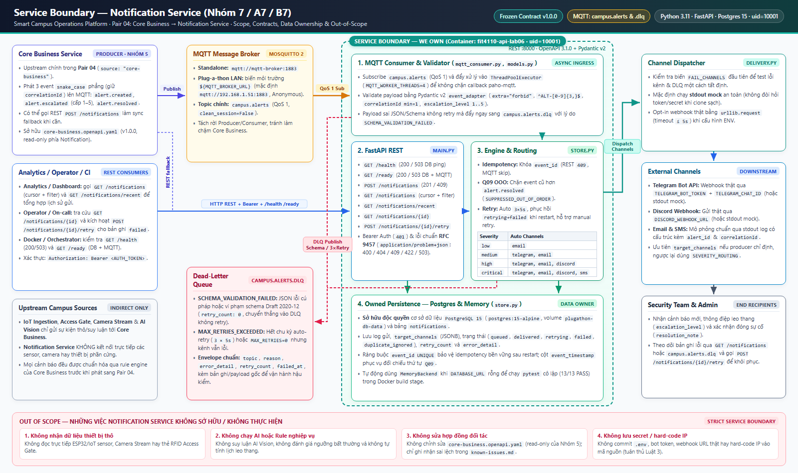

Tài liệu kiến trúc chi tiết nằm ở [`06_Plugathon/docs/service_boundary.md`](./06_Plugathon/docs/service_boundary.md) và [`06_Plugathon/docs/architecture_one_pager.md`](./06_Plugathon/docs/architecture_one_pager.md).

## 2. Cấu trúc thư mục và tiến độ qua các bài Lab

Mã nguồn, tài liệu hợp đồng và minh chứng được sắp theo sáu thư mục Lab của FIT4110 Student Kit:

```text
Notification_Service/
├── README.md                                       # Tài liệu tổng quan và hướng dẫn chạy
├── design-system/smart-campus-notification-center/
│   └── MASTER.md                                   # Bảng màu và quy chuẩn giao diện Demo UI
├── .github/workflows/                              # GitHub Actions CI cho Lab 04, Lab 05, Lab 06
│   ├── lab04-docker-newman.yml
│   ├── lab05-check.yml
│   └── lab06-plugathon-demo.yml
│
├── 01_Setup/                                       # Lab 01: Môi trường và ranh giới dịch vụ
│   ├── README.md
│   ├── CONTRIBUTION.md
│   ├── compose/docker-compose.smoke.yml
│   ├── evidence/buoi-01/service-boundary.md
│   └── scripts/
│
├── 02_OpenAPI/                                     # Lab 02: OpenAPI 3.1.0 và Event Contract Pair 04
│   ├── README.md
│   ├── CONTRIBUTION.md
│   ├── openapi.yaml
│   ├── event-contract-04-core-notification.md      # Hợp đồng bất đồng bộ với Nhóm 5
│   ├── campus-spectral.yaml
│   ├── negotiation-log.md                          # Nhật ký đàm phán 6 điểm liên nhóm
│   ├── VERSIONING.md
│   └── evidence/buoi-02/                           # Log Spectral (0 lỗi) và ảnh Prism mock
│
├── 03_Postman/                                     # Lab 03: Postman, Prism Mock, Newman và Queue Async
│   ├── README.md
│   ├── CONTRIBUTION.md
│   ├── contracts/notification.openapi.yaml
│   ├── postman/collections/                        # Postman Collection TC01 đến TC16
│   ├── queue-contract-tests/pair-04-core-notification/ # JSON Schema Draft 2020-12 (Ajv) & Stub Q05-Q09
│   └── reports/
│
├── 04_Docker/                                      # Lab 04: Docker container đơn lẻ (REST Fallback)
│   ├── Dockerfile                                  # Multi-stage, user non-root uid=10001
│   ├── .dockerignore
│   ├── .env.example                                # Mặc định MQTT_ENABLED=false
│   ├── .spectral.yaml
│   ├── Makefile & RUN_LOCAL.md
│   ├── src/notification_app/                       # FastAPI + Pydantic v2 chạy MemoryBackend
│   ├── postman/                                    # Newman suite (18 requests)
│   └── reports/
│
├── 05_Compose/                                     # Lab 05: Docker Compose Stack & Demo Control Center
│   ├── docker-compose.yml                          # api (:8000) + PostgreSQL 15 (:5432) + Mosquitto 2 (:1883)
│   ├── docker-compose.plugathon.yml                # Overlay nối mạng class-net
│   ├── Dockerfile & .env.example
│   ├── src/notification_app/
│   │   ├── config.py, models.py, main.py, mqtt_consumer.py, store.py, delivery.py, demo_routes.py
│   │   └── static/{index.html,styles.css,charts.js,scenarios.js,app.js}
│   ├── tests/                                      # test_api.py (13 ca) + test_demo_ui.py (9 ca)
│   ├── scripts/
│   ├── RUN_COMPOSE.md
│   └── evidence/buoi-05/
│
├── 06_Plugathon/                                   # Lab 06: Nghiệm thu Plug-a-thon
│   ├── docker-compose.yml
│   ├── docker-compose.external-broker.yml          # Overlay nối broker lớp mqtt://192.168.1.51:1883
│   ├── .env.example & Makefile & RUN_PLUGATHON.md
│   ├── contracts/                                  # 9 file hợp đồng đóng băng v1.0.0 + SHA-256
│   ├── diagrams/
│   ├── docs/
│   ├── postman/ & reports/                         # Collection Lab 06 (21 requests / 37 assertions)
│   ├── scripts/                                    # core_business_simulator.py, run_plugathon_e2e.py, verify_frozen_contracts.py
│   ├── slides/                                     # Slide trình bày (HTML và PDF)
│   └── evidence/                                   # Logs, 9 ảnh chụp live UI/Demo, fault_record.md, 11 hình báo cáo
│
└── demo/                                           # Demo Pack chạy tự động dưới 5 phút
    ├── run_demo.ps1 & run_demo.sh
    ├── demo_walkthrough.log
    ├── video_script_2_3min.md
    └── README.md & RUN_DEMO.md
```

Tiến độ thực hiện qua từng buổi thực hành:

| Lab | Công việc chính | Tài liệu bàn giao |
| --- | --- | --- |
| Lab 01 | Cài công cụ Docker, chạy smoke test và xác định ranh giới dịch vụ với Pair 04 | [`01_Setup/evidence/buoi-01/service-boundary.md`](./01_Setup/evidence/buoi-01/service-boundary.md) |
| Lab 02 | Chốt hợp đồng với Core Business (`Nhóm 5`), viết OpenAPI 3.1.0, `ProblemDetails` RFC 9457 và Event Contract Pair 04 | [`02_OpenAPI/openapi.yaml`](./02_OpenAPI/openapi.yaml), [`negotiation-log.md`](./02_OpenAPI/negotiation-log.md) |
| Lab 03 | Viết JSON Schema Draft 2020-12 (`19/19` ca Ajv + Stub Q05 đến Q09), chạy Prism Mock và Postman/Newman | [`03_Postman/queue-contract-tests/`](./03_Postman/queue-contract-tests/), [`newman-report.html`](./03_Postman/reports/newman-report.html) |
| Lab 04 | Viết FastAPI + Pydantic v2, đóng gói multi-stage non-root `Dockerfile`, pass `13/13` pytest và `18/18` Newman | [`04_Docker/Dockerfile`](./04_Docker/Dockerfile), [`04_Docker/RUN_LOCAL.md`](./04_Docker/RUN_LOCAL.md) |
| Lab 05 | Chạy Compose gồm `api`, PostgreSQL 15 và Mosquitto 2 với `ThreadPoolExecutor`, DLQ, Demo Control Center 5 tab, `22/22` pytest và `19/19` Newman | [`05_Compose/docker-compose.yml`](./05_Compose/docker-compose.yml), [`05_Compose/RUN_COMPOSE.md`](./05_Compose/RUN_COMPOSE.md) |
| Lab 06 | Khóa `9/9` hợp đồng SHA-256, thêm overlay Dual-Mode `class-net`, đạt `13/13` E2E, `21/21` Newman (`37/37` assertions, `2.3s`, TB `27ms`) và Demo Pack (`28.6s`) | [`06_Plugathon/RUN_PLUGATHON.md`](./06_Plugathon/RUN_PLUGATHON.md), [`demo/README.md`](./demo/README.md) |

## 3. Giao diện Demo Control Center tại `http://localhost:8000/`

Khi chạy stack Compose, dịch vụ mở Web Console ở `/` và `/demo` trên cổng `:8000` bên cạnh tài liệu `/docs` và `/redoc`. Giao diện dùng hai bảng màu (nền tối mặc định và chế độ sáng độ tương phản cao) theo [`MASTER.md`](./design-system/smart-campus-notification-center/MASTER.md), vẽ biểu đồ bằng Pure SVG trong [`charts.js`](./05_Compose/src/notification_app/static/charts.js), chạy hoàn toàn offline không cần CDN và tách biệt khỏi `/openapi.json` nhờ gắn `include_in_schema=False` trong [`demo_routes.py`](./05_Compose/src/notification_app/demo_routes.py).

Khi bật ở môi trường `local` hoặc `plugathon` với token mặc định, nút **Use Dev Token** điền sẵn `plugathon-dev-token`. Nếu hệ thống chạy bằng `AUTH_TOKEN` riêng bên ngoài môi trường lab, trường `dev_token_hint` từ `/demo-api/config` sẽ trả `null` để không làm lộ khóa bí mật.

### Tab 1: Overview

Hiển thị 5 chỉ số lấy trực tiếp từ PostgreSQL (`Total Logged`, `Delivered`, `Retrying`, `Failed / DLQ`, `Suppressed Q09`), biểu đồ Donut theo trạng thái, biểu đồ cột theo từng kênh, đường sparkline đo độ trễ API, sơ đồ đường đi Pair 04, bảng ánh xạ `SEVERITY_ROUTING` và 6 bản ghi mới nhất.

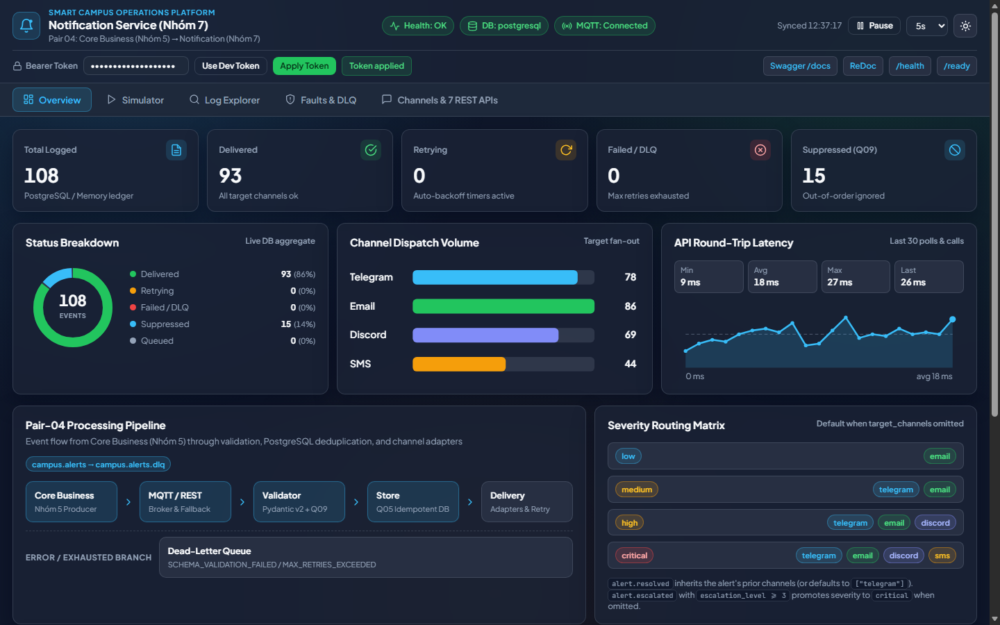

### Tab 2: Simulator

Chứa 9 nút chạy nhanh kịch bản bảo vệ (MQTT Lifecycle, REST Lifecycle, trùng `event_id` Q05 trên MQTT và REST `409`, `Q09` đến muộn, `Q08` sai schema đẩy sang DLQ, các mã lỗi `401`, `422`, `400` chuẩn RFC 9457) cùng biểu mẫu soạn event hỗ trợ chọn kênh, đồng bộ hai chiều với JSON thô và gửi qua MQTT hoặc REST.

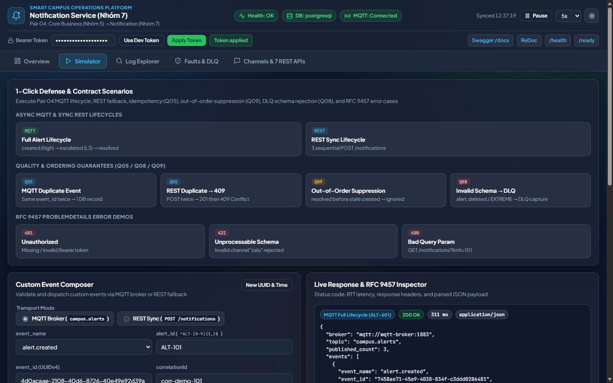

### Tab 3: Log Explorer

Tra cứu lịch sử từ `GET /notifications` theo `alert_id`, `status`, `channel`, kích thước trang `10`/`20`/`50` và phân trang con trỏ Base64 (`Previous` / `Next`). Bấm **Inspect** trên một dòng sẽ mở ngăn kéo bên phải hiển thị toàn bộ metadata, JSON gốc và nút **Manual Retry**.

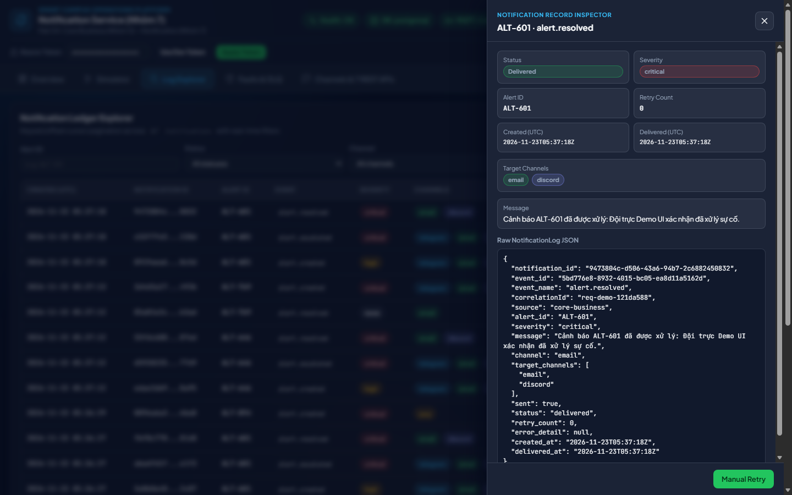

### Tab 4: Faults & DLQ

Cho phép bật lỗi giả lập từng kênh (`FAIL_CHANNELS`), đặt `MAX_RETRIES` từ `0` đến `10` và `RETRY_INTERVAL_SECONDS` ngay khi dịch vụ đang chạy mà không cần khởi động lại container. Phía bên phải có quy trình 3 bước minh họa tiêm lỗi kênh `sms`, xem gói `MAX_RETRIES_EXCEEDED` và `SCHEMA_VALIDATION_FAILED` trong hộp bắt tin `campus.alerts.dlq`, sau đó reset lỗi và bấm **Quick Retry** để khôi phục sang `delivered`.

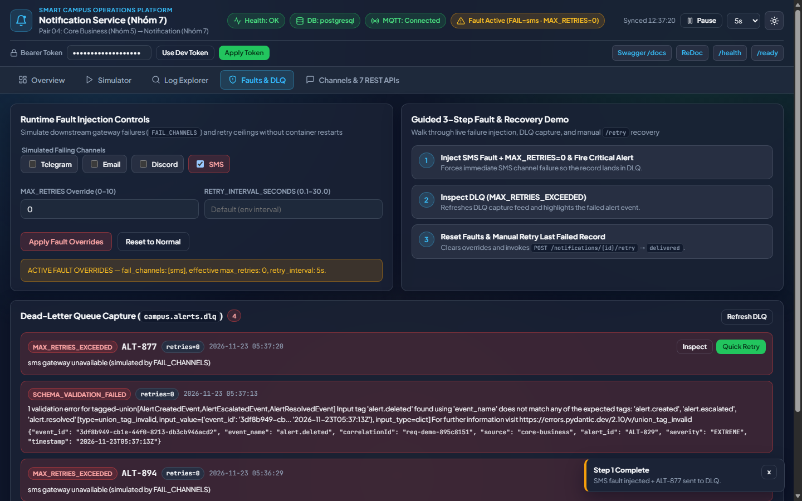

### Tab 5: Channels & 7 REST APIs

Theo dõi dòng tin nhắn đầu ra cho từng kênh (`Telegram`, `Email`, `Discord`, `SMS`, gắn nhãn `Stdout Mock` hoặc `Real Webhook`) và cung cấp khung **7 Official OpenAPI 3.1.0 REST Endpoints Tester** để gọi thử trực tiếp cả 7 endpoint chính thức kèm mã HTTP, độ trễ và JSON trả về.

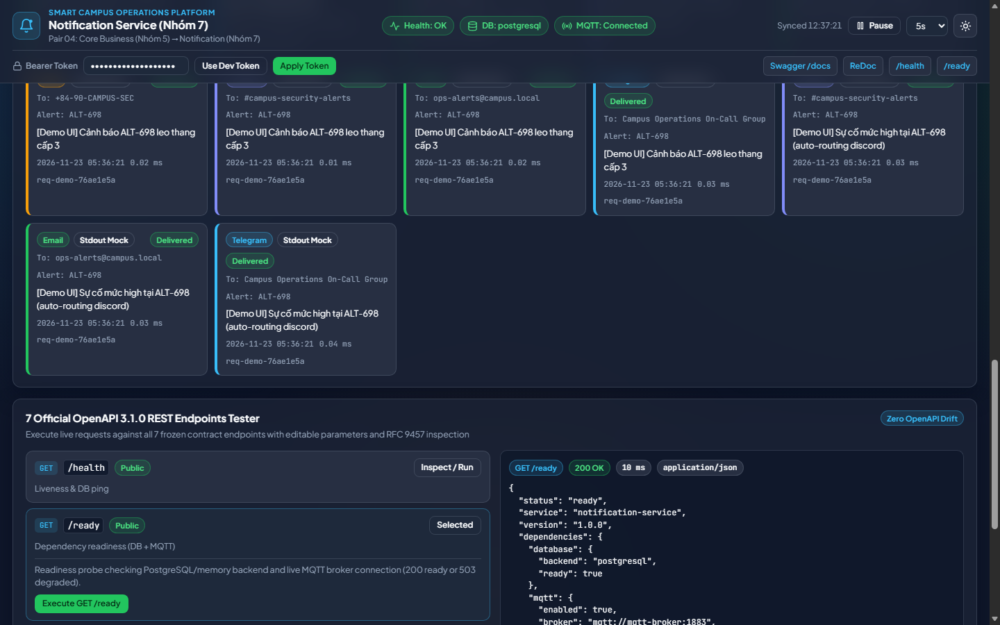

### Chế độ sáng High-Contrast Light Mode

Nút chuyển giao diện trên thanh tiêu đề cho phép đổi giữa nền tối và nền sáng (`[data-theme="light"]`), lưu trạng thái vào `localStorage`, đồng thời hỗ trợ tạm dừng auto-poll (`3s`, `5s`, `10s`) hoặc tự dừng khi ẩn tab trình duyệt.

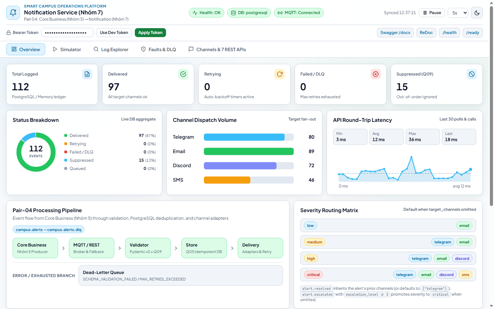

## 4. API REST, hợp đồng MQTT và sơ đồ tích hợp (`v1.0.0` Frozen)

### A. Danh mục 7 REST Endpoints ([`notification.openapi.yaml`](./06_Plugathon/contracts/notification.openapi.yaml))

| Method | Endpoint | Xác thực | Chức năng | Mã phản hồi |
| --- | --- | --- | --- | --- |
| `GET` | `/health` | Public | Kiểm tra API đang chạy, cấu hình broker và ping PostgreSQL | `200`, `503` |
| `GET` | `/ready` | Public | Kiểm tra đồng thời `dependencies.database.ready` và `dependencies.mqtt.connected` | `200`, `503` |
| `POST` | `/notifications` | Bearer Token | Nhận `alert.created`, `alert.escalated`, `alert.resolved` qua REST dự phòng, chặn trùng `event_id` | `201`, `400`, `401`, `409`, `422`, `500` |
| `GET` | `/notifications` | Bearer Token | Lọc lịch sử theo `alert_id`, `status`, `channel` và phân trang cursor Base64 (`cursor`, `limit`) | `200`, `400`, `401`, `500` |
| `GET` | `/notifications/recent` | Bearer Token | Lấy nhanh các bản ghi thông báo mới nhất cho Dashboard và Analytics | `200`, `400`, `401`, `500` |
| `GET` | `/notifications/{notification_id}` | Bearer Token | Xem chi tiết trạng thái gửi, `retry_count`, `target_channels` và `error_detail` theo UUID | `200`, `401`, `404`, `500` |
| `POST` | `/notifications/{notification_id}/retry` | Bearer Token | Kích hoạt gửi lại thủ công bản ghi lỗi (gồm bản ghi đã qua DLQ sau khi hết auto-retry) | `200`, `401`, `404`, `409`, `500` |

### B. Hợp đồng sự kiện MQTT Pair 04 ([`event-contract.md`](./06_Plugathon/contracts/event-contract.md))

- Topic subscribe chính là `campus.alerts` (`QoS 1`, `clean_session=False`), nhận JSON `snake_case` kèm `correlationId` cho ba loại sự kiện: `alert.created`, `alert.escalated` (cấp độ `1` đến `5`, từ cấp `3` trở lên tự nâng mức thành `critical`) và `alert.resolved` (ghi mốc đóng sự cố để áp dụng quy tắc `Q09`).
- Topic hàng đợi lỗi là `campus.alerts.dlq` (`QoS 1`), chứa metadata (`reason`, `error_detail`, `retry_count`, `failed_at`) cho hai trường hợp: `SCHEMA_VALIDATION_FAILED` (chuyển thẳng vào DLQ với `retry_count=0`) và `MAX_RETRIES_EXCEEDED` (sau `3` lần auto-retry, mỗi lần cách `5s`).
- Định tuyến mặc định theo `severity` khi payload bỏ trống `target_channels`: `low` -> `[email]`, `medium` -> `[telegram, email]`, `high` -> `[telegram, email, discord]`, `critical` -> `[telegram, email, discord, sms]`.

### C. Topology tích hợp Upstream / Downstream

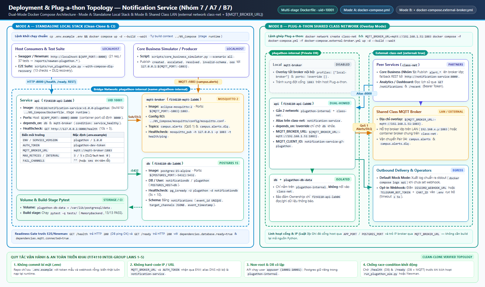

| Quan hệ | Hệ thống | Giao thức và hợp đồng | Mục đích |
| --- | --- | --- | --- |
| Upstream Producer chính | Core Business Service (`Nhóm 5 / A6 / B6`) | MQTT `campus.alerts` (`Pair 04 v1.0`) và REST `POST /notifications` | Phát `alert.created`, `alert.escalated`, `alert.resolved`; đối chiếu ngược tại [`core-business.openapi.yaml`](./06_Plugathon/contracts/core-business.openapi.yaml) |
| Upstream REST Consumers | Analytics Service, Demo UI, Operator | HTTP REST (`GET /notifications`, `GET /notifications/recent`, `POST .../retry`) | Tra cứu nhật ký cảnh báo và kích hoạt gửi lại thủ công |
| Hạ tầng phụ thuộc | Mosquitto 2 (`mqtt-broker:1883` / `192.168.1.51:1883`), PostgreSQL 15 (`db:5432`) | MQTT v3.1.1 QoS 1, TCP PostgreSQL | Truyền tin bất đồng bộ và lưu bảng 18 cột với ràng buộc `event_id UNIQUE` |
| Downstream Delivery | Telegram Bot API, Discord Webhook, Email/SMS Gateway (mặc định stdout mock) | HTTPS (`<= 5.0s` timeout) / Structured Stdout | Gửi thông báo ra kênh đích tới Security Team và Campus Admin |

Tài liệu hợp đồng nằm ở [`contracts/notification.openapi.yaml`](./06_Plugathon/contracts/notification.openapi.yaml), [`contracts/producer-consumer-handshake.md`](./06_Plugathon/contracts/producer-consumer-handshake.md), [`docs/endpoint_catalog.md`](./06_Plugathon/docs/endpoint_catalog.md), [`docs/integration_notes.md`](./06_Plugathon/docs/integration_notes.md) và [`docs/changelog.md`](./06_Plugathon/docs/changelog.md).

## 5. Công nghệ và công cụ sử dụng

| Thành phần | Công nghệ | Vị trí và nhiệm vụ |
| --- | --- | --- |
| API và Runtime | Python 3.11, FastAPI, Pydantic v2, Uvicorn | Cài đặt 7 HTTP endpoint và schema validation (`extra='forbid'`) trong [`05_Compose/src/notification_app/`](./05_Compose/src/notification_app/) |
| Demo Control Center | HTML5, Vanilla JS ES5, Pure SVG Charts, CSS Glassmorphism | Web UI 5 tab chạy offline tại [`static/`](./05_Compose/src/notification_app/static/) và [`demo_routes.py`](./05_Compose/src/notification_app/demo_routes.py) |
| Cơ sở dữ liệu | PostgreSQL 15 (`postgres:15-alpine`), `psycopg3` | Lưu bảng `notifications` (18 cột, JSONB `target_channels`, 2 index); chuyển sang `MemoryBackend` khi chạy unit test không có DB |
| Message Broker | Eclipse Mosquitto 2 (`eclipse-mosquitto:2`), `paho-mqtt` | Lắng nghe `campus.alerts` và đẩy `campus.alerts.dlq` qua `ThreadPoolExecutor` (`MQTT_WORKER_THREADS=4`) |
| Kênh chuyển phát | Stdout log mặc định và HTTPS opt-in (`urllib.request`, `<= 5.0s`) | Gửi Telegram/Discord khi điền biến `.env`, hỗ trợ tiêm lỗi qua `FAIL_CHANNELS` và `/demo-api/faults` |
| Hợp đồng và kiểm thử | OpenAPI 3.1.0, JSON Schema Draft 2020-12, Ajv, Spectral, Prism, Newman, `pytest` | Spectral `0` lỗi, SHA-256 `9/9`, Queue Async `19/19`, `pytest` `22/22`, Newman `21/21` (`37/37` assertions) |
| Container và CI | Docker multi-stage non-root (`uid=10001`), Docker Compose v2, GitHub Actions | Tự động hóa build và kiểm thử tại [`.github/workflows/`](./.github/workflows/) |

## 6. Hướng dẫn khởi chạy và kiểm thử đầy đủ

### Yêu cầu môi trường trên máy

Trước khi chạy, máy cần cài sẵn:

- Docker Desktop hoặc Docker Engine có Docker Compose v2 (`docker compose version`), đảm bảo Docker Desktop đã khởi động xong.
- Python 3.11 trở lên (`python --version`).
- Node.js 20 trở lên và `npm` (để chạy Spectral lint OpenAPI và Newman test).
- Git và `curl` (trên Windows PowerShell có sẵn `Invoke-RestMethod`).

### Cách 1: Chạy tự động trọn bộ bằng 1 lệnh (`./demo/`)

Cách nhanh nhất sau khi clone repo để kiểm tra hợp đồng SHA-256, lint OpenAPI, build 3 container, kiểm thử E2E 13 kịch bản (gồm tiêm lỗi DLQ và `/retry`), chạy 21 requests Newman và mở giao diện Demo UI.

Trên Windows PowerShell:

```powershell
cd e:\HT\Nam4_HK1\DichVuKetNoiVaCongNgheNenTang\Notification_Service

# Chạy toàn bộ quy trình kiểm chứng (~28.6s) và GIỮ stack tiếp tục chạy để mở ngay Demo UI
.\demo\run_demo.ps1

# Hoặc chạy kiểm chứng xong rồi tự động dừng và xóa container/volume (-Clean)
.\demo\run_demo.ps1 -Clean
```

Trên Linux / macOS / Git Bash:

```bash
cd Notification_Service
chmod +x ./demo/run_demo.sh

# Chạy và giữ stack đang bật
./demo/run_demo.sh

# Hoặc chạy xong tự dọn container và volume
./demo/run_demo.sh --clean
```

Sau khi script báo `ALL CHECKS PASSED`, mở trình duyệt vào các địa chỉ sau:

- Giao diện Demo Control Center: `http://127.0.0.1:8000/` (hoặc `http://127.0.0.1:8000/demo`, Bearer token mặc định là `plugathon-dev-token` hoặc bấm **Use Dev Token**).
- Swagger UI chính thức: `http://127.0.0.1:8000/docs`
- Tài liệu ReDoc: `http://127.0.0.1:8000/redoc`
- Healthcheck & Readiness: `http://127.0.0.1:8000/health` và `http://127.0.0.1:8000/ready`

Nhật ký thực thi thực tế được lưu tại [`demo/demo_walkthrough.log`](./demo/demo_walkthrough.log) (`28.6s`, E2E `13/13 checks PASSED`, Newman `21/21` requests, `37/37` assertions, avg `27ms`). Xem thêm chi tiết các cờ tùy chọn tại [`demo/README.md`](./demo/README.md), [`demo/RUN_DEMO.md`](./demo/RUN_DEMO.md) và kịch bản trình bày tại [`demo/video_script_2_3min.md`](./demo/video_script_2_3min.md).

### Cách 2: Khởi chạy thủ công bằng Docker Compose ở chế độ độc lập (`06_Plugathon/`)

Phù hợp khi muốn tự chạy từng bước, giữ container chạy để test thủ công với Postman, bắn sự kiện giả lập từ terminal hoặc xem log PostgreSQL/Mosquitto.

Bước 1: Tạo `.env` an toàn và kiểm tra hợp đồng trước khi bật

Trên Windows PowerShell:

```powershell
cd e:\HT\Nam4_HK1\DichVuKetNoiVaCongNgheNenTang\Notification_Service\06_Plugathon
Copy-Item .env.example .env
npm ci
python scripts/verify_frozen_contracts.py
npm run lint:openapi
```

Trên Linux / macOS / Git Bash:

```bash
cd Notification_Service/06_Plugathon
cp .env.example .env
npm ci
python scripts/verify_frozen_contracts.py
npm run lint:openapi
```

Bước 2: Build và bật 3 container (`api`, `db`, `mqtt-broker`)

```bash
docker compose up -d --build --wait
docker compose ps
docker compose exec -T api id
```

Kỳ vọng cả 3 container `fit4110-api-lab06` (:8000), `fit4110-db-lab06` (:5432) và `fit4110-mqtt-lab06` (:1883) đều ở trạng thái `healthy`, và user trong API container là `uid=10001(appuser)`.

Bước 3: Kiểm tra endpoint `/health` và `/ready`

Trên Windows PowerShell:

```powershell
Invoke-RestMethod http://127.0.0.1:8000/health
Invoke-RestMethod http://127.0.0.1:8000/ready
```

Trên Linux / macOS / Git Bash:

```bash
curl -fsS http://127.0.0.1:8000/health
curl -fsS http://127.0.0.1:8000/ready
```

Chỉ khi `status: "ready"`, `dependencies.database.ready: true` và `dependencies.mqtt.connected: true` thì dịch vụ mới sẵn sàng nhận tin từ MQTT.

Bước 4: Chạy giả lập Core Business, kiểm thử E2E và Newman

```bash
# Bắn đủ các kịch bản Pair 04 (created, escalated, resolved, invalid-schema, ooo) lên topic campus.alerts
python scripts/core_business_simulator.py --scenario all

# Chạy trọn bộ E2E 13 bước kèm tiêm lỗi SMS -> DLQ MAX_RETRIES_EXCEEDED -> /retry phục hồi
python scripts/run_plugathon_e2e.py --with-compose-dlq-recovery

# Chạy 21 requests / 37 assertions Newman và xuất báo cáo ra 06_Plugathon/reports/
npm run test:plugathon
```

Bước 5: Dừng hệ thống

```bash
# Dừng container nhưng giữ lại dữ liệu PostgreSQL trong volume plugathon-db-data
docker compose down

# Hoặc dừng container và xóa toàn bộ volume để làm sạch DB từ đầu
docker compose down -v
```

### Cách 3: Ghép nối với nhóm Core Business trên mạng chung Plug-a-thon LAN (`class-net`)

Khi tích hợp cùng nhóm Core Business (Nhóm 5) qua MQTT Broker chung của lớp (`192.168.1.51:1883`), dùng file overlay [`docker-compose.external-broker.yml`](./06_Plugathon/docker-compose.external-broker.yml) để tự động tắt Mosquitto cục bộ và gắn container `api` (alias DNS `notification-service`) vào mạng `class-net`, trong khi PostgreSQL vẫn khóa trong mạng nội bộ `plugathon-internal`.

Trên Windows PowerShell:

```powershell
cd e:\HT\Nam4_HK1\DichVuKetNoiVaCongNgheNenTang\Notification_Service\06_Plugathon
Copy-Item .env.example .env -ErrorAction SilentlyContinue

# Tạo mạng dùng chung (bỏ qua nếu trên máy đã tồn tại class-net)
docker network create class-net

# Khởi chạy trỏ tới MQTT Broker chung của lớp
$env:MQTT_BROKER_URL="mqtt://192.168.1.51:1883"
docker compose -f docker-compose.yml -f docker-compose.external-broker.yml up -d --build --wait

# Xác nhận đã kết nối Broker lớp thành công
Invoke-RestMethod http://127.0.0.1:8000/ready
```

Trên Linux / macOS / Git Bash:

```bash
docker network create class-net || true
cd Notification_Service/06_Plugathon
cp -n .env.example .env || true
MQTT_BROKER_URL=mqtt://192.168.1.51:1883 \
  docker compose -f docker-compose.yml -f docker-compose.external-broker.yml up -d --build --wait
curl -fsS http://127.0.0.1:8000/ready
```

Chạy kiểm tra trực tiếp qua broker chung của lớp:

```bash
python scripts/core_business_simulator.py --broker mqtt://192.168.1.51:1883 --scenario lifecycle
python scripts/run_plugathon_e2e.py --broker mqtt://192.168.1.51:1883
```

Bật gửi tin thật ra Telegram hoặc Discord (tùy chọn khi demo trực tiếp): mở file `06_Plugathon/.env` vừa tạo, điền `TELEGRAM_BOT_TOKEN`, `TELEGRAM_CHAT_ID` hoặc `DISCORD_WEBHOOK_URL` rồi chạy lại `docker compose up -d` để áp dụng cấu hình mới (file `.env` đã có trong `.gitignore` nên không bị commit nhầm).

Xem thêm hướng dẫn tại [`06_Plugathon/RUN_PLUGATHON.md`](./06_Plugathon/RUN_PLUGATHON.md), [`05_Compose/RUN_COMPOSE.md`](./05_Compose/RUN_COMPOSE.md) và [`06_Plugathon/docs/fault_injection_runbook.md`](./06_Plugathon/docs/fault_injection_runbook.md).

### Cách 4: Chạy container đơn lẻ Lab 04 (`04_Docker/`) và Unit/UI test `pytest` (`05_Compose/`)

Nếu chỉ cần chạy container REST Fallback (`MQTT_ENABLED=false`, lưu `MemoryBackend`) theo bài Lab 04:

```bash
cd Notification_Service/04_Docker
npm install
docker build --target test -t fit4110/notification-service:test .
docker build -t fit4110/notification-service:lab04 .
docker run -d --rm --name fit4110-notify-lab04 -p 8000:8000 --env-file .env.example fit4110/notification-service:lab04
curl -fsS http://localhost:8000/health
npm run test:local
docker stop fit4110-notify-lab04
```

Kỳ vọng Lab 04: `18/18` requests pass, `33/33` assertions pass (chi tiết xem [`04_Docker/RUN_LOCAL.md`](./04_Docker/RUN_LOCAL.md)).

Để chạy toàn bộ Unit Test và Demo UI Test (`22` test cases gồm `13` ca [`test_api.py`](./05_Compose/tests/test_api.py) + `9` ca [`test_demo_ui.py`](./05_Compose/tests/test_demo_ui.py)) trên `MemoryBackend` mà không cần PostgreSQL hay Mosquitto:

```bash
# Chạy trực tiếp trên Python máy host
cd Notification_Service/05_Compose
pip install -r requirements.txt -r requirements-dev.txt
pytest -v tests

# Hoặc chạy sạch trong Docker test stage từ thư mục Notification_Service
docker build --target test -t fit4110/notification-service:test 05_Compose
docker run --rm fit4110/notification-service:test /opt/venv/bin/python -m pytest -v tests
```

### Xử lý các lỗi thường gặp khi khởi chạy

| Triệu chứng | Nguyên nhân | Cách khắc phục |
| --- | --- | --- |
| `failed to connect to the docker API` / `dockerDesktopLinuxEngine` | Docker Desktop chưa mở hoặc chưa khởi động xong engine | Mở ứng dụng Docker Desktop (hoặc chạy `docker desktop start`) và đợi `docker info` hết lỗi trước khi chạy script |
| `Bind for 0.0.0.0:8000 / 5432 / 1883 failed: port is already allocated` | Container Lab 04/05 hoặc dịch vụ khác đang giữ cổng | Tắt stack cũ bằng `docker compose down` tại thư mục cũ, hoặc sửa `APP_PORT` / `POSTGRES_PORT` / `MQTT_PORT` trong `06_Plugathon/.env` |
| `network class-net declared as external, but could not be found` | Chưa tạo bridge network `class-net` trước khi chạy overlay Plug-a-thon | Chạy `docker network create class-net` rồi chạy lại `docker compose up -d` |
| `GET /ready` trả `503` với `mqtt.connected: false` | Broker `192.168.1.51:1883` chưa bật hoặc khác dải mạng LAN | Kiểm tra lại kết nối LAN tới IP broker, hoặc chạy chế độ Standalone ở Cách 2 |
| Lỗi xác thực PostgreSQL khi đổi `POSTGRES_PASSWORD` | Volume `plugathon-db-data` đã tạo từ mật khẩu cũ | Chạy `docker compose down -v && docker compose up -d --build --wait` |

## 7. Độ tin cậy và an toàn hệ thống

- Hợp đồng REST OpenAPI 3.1.0 và JSON Schema Draft 2020-12 khóa phiên bản `v1.0.0`, đối chiếu 9/9 mã băm SHA-256 trước khi chạy; toàn bộ route Demo UI dùng `include_in_schema=False` nên không làm lệch `/openapi.json`.
- Khóa `event_id UNIQUE` trong PostgreSQL chặn gửi lặp QoS 1 (`Q05`), đồng thời kiểm tra timestamp `alert.resolved` gần nhất để loại cảnh báo đến trễ (`Q09`).
- Khi kênh gửi lỗi, worker tự thử lại tối đa 3 lần (mỗi 5s), đẩy tin thất bại sang `campus.alerts.dlq`, tự thu hồi các bản ghi bị kẹt ở trạng thái `retrying` sau khởi động lại (`recover_stuck_retrying()`) và hỗ trợ phát lại qua `/notifications/{id}/retry`.
- Toàn bộ secret, chuỗi kết nối DB, broker URL và webhook nạp qua `.env`; có thể đổi giữa broker cục bộ và broker chung lớp không cần build lại Docker image.
- Container API chạy bằng user không có quyền root (`uid=10001`), PostgreSQL nằm riêng trong mạng `plugathon-internal`, SQL dùng parameterized query `%s`, giao diện escape HTML (`escapeHtml`) tránh XSS và không trả `dev_token_hint` khi dùng `AUTH_TOKEN` tùy chỉnh.

## 8. Minh chứng kiểm thử và tài liệu nộp

Báo cáo Word: [`Nhom-7_Nguyen-Minh-Phuong.docx`](../Nhom-7_Nguyen-Minh-Phuong.docx)  
Tổng hợp minh chứng Lab 06: [`06_Plugathon/evidence/README.md`](./06_Plugathon/evidence/README.md)  
Nhật ký thực thi: [`demo_walkthrough.log`](./demo/demo_walkthrough.log) (`28.6s`), [`compose-ps.txt`](./06_Plugathon/evidence/logs/compose-ps.txt), [`health-ready.json`](./06_Plugathon/evidence/logs/health-ready.json), [`plugathon-e2e.log`](./06_Plugathon/evidence/logs/plugathon-e2e.log), [`mqtt-handshake.log`](./06_Plugathon/evidence/logs/mqtt-handshake.log), [`dlq-fault.log`](./06_Plugathon/evidence/logs/dlq-fault.log), [`api-container.log`](./06_Plugathon/evidence/logs/api-container.log)  
Báo cáo Newman Lab 06: [`newman-plugathon.html`](./06_Plugathon/reports/newman-plugathon.html) và [`newman-plugathon.xml`](./06_Plugathon/reports/newman-plugathon.xml) (`21/21` requests, `37/37` assertions, `0` failed, `2.3s`, avg `27ms`)  
Bộ 11 hình dùng trong báo cáo Word: [`06_Plugathon/evidence/report_figures/`](./06_Plugathon/evidence/report_figures/)  
Biên bản tiêm lỗi và Runbook: [`fault_record.md`](./06_Plugathon/evidence/fault_record.md), [`fault_injection_runbook.md`](./06_Plugathon/docs/fault_injection_runbook.md)  
Slide trình bày kiến trúc: [`architecture_presentation.html`](./06_Plugathon/slides/architecture_presentation.html) và [`architecture_presentation.pdf`](./06_Plugathon/slides/architecture_presentation.pdf)  
Video demo và phản tư cá nhân: [`demo_video_link.txt`](./06_Plugathon/evidence/demo_video_link.txt), [`individual_reflection.md`](./06_Plugathon/evidence/reflection/individual_reflection.md)  
Giới hạn hệ thống và checklist nộp bài: [`known-issues.md`](./06_Plugathon/known-issues.md), [`plugathon_checklist.md`](./06_Plugathon/checklists/plugathon_checklist.md), [`submission_checklist.md`](./06_Plugathon/checklists/submission_checklist.md)

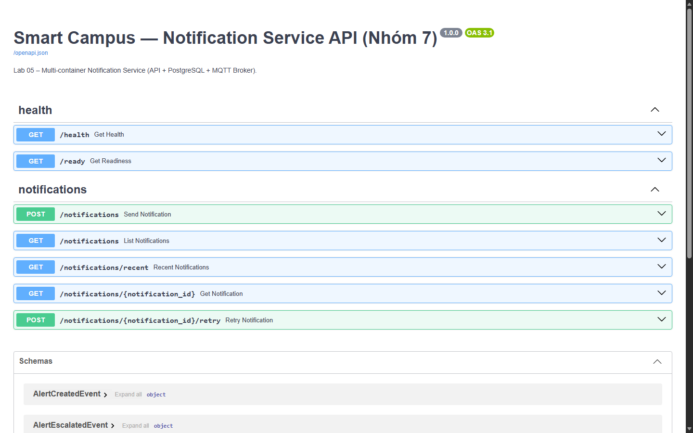

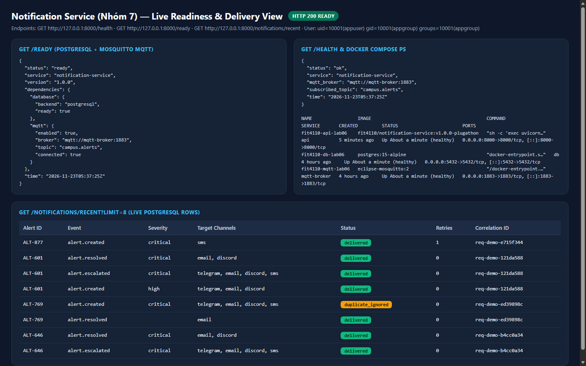

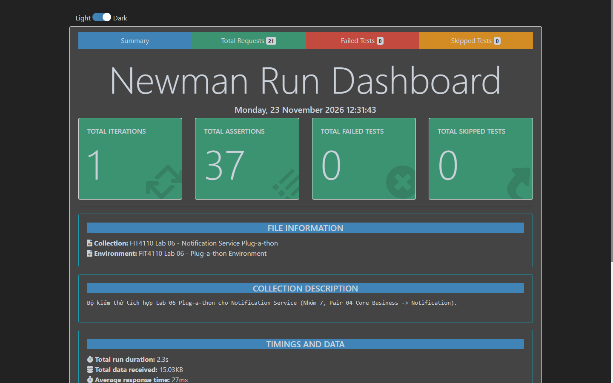

## 9. Thông tin nhóm thực hiện

Học phần: FIT4110, Dịch vụ kết nối và Công nghệ nền tảng  
Nhóm thực hiện: Nhóm 7 (`A7 / B7`, Notification Service, Pair 04)  
Phân công tỷ lệ công việc: Nguyễn Minh Phượng (`1677030156`), 75%; Hoàng Minh Quân (`1771040019`), 25%  
Docker Image Tag: `fit4110/notification-service:lab04`, `fit4110/notification-service:v1.0.0-plugathon`
