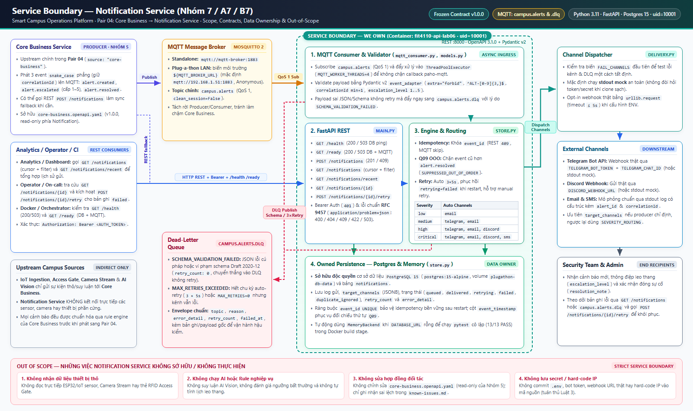
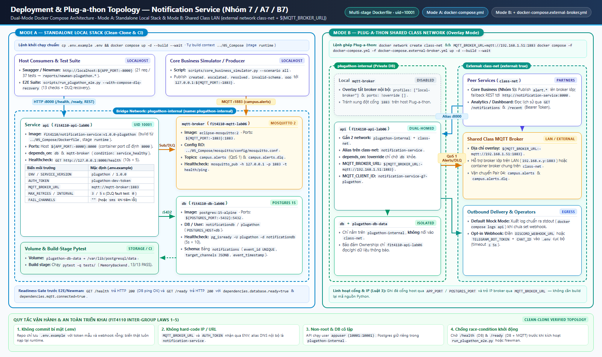

# FIT4110 — 5-Minute Demo Pack: Notification Service (Nhóm 6)

Thư mục [`demo/`](./) là **Demo Pack tổng hợp** giúp giảng viên, thành viên nhóm tích hợp hoặc máy chấm tái lập toàn bộ hệ thống **Notification Service (`Nhóm 6`)** từ clone sạch trong vòng **≤ 5 phút**, đáp ứng đầy đủ **7 cổng đánh giá** trong `DemoPack.md` và **14 thành phần Demo Pack cuối kỳ**.

- **Sinh viên thực hiện:** Nguyễn Minh Phượng (`<MãSinhViên>`)
- **Nhóm / Service:** Nhóm 6 *(hoặc A7 / B7)* — **Notification Service**
- **Cặp tích hợp:** **Pair 04 (`Core Business → Notification Service`)** — Smart Campus Operations Platform

---

## 1. Problem & Boundary (Bài toán & Ranh giới dịch vụ)

**Notification Service** nhận các sự kiện cảnh báo đã chuẩn hóa từ **Core Business Service** (qua MQTT topic `campus.alerts` hoặc REST sync fallback `POST /notifications`), thực hiện validate schema, chống trùng theo `event_id`, chặn cảnh báo đến trễ `Q09`, tự định tuyến và chuyển phát đa kênh (`telegram`, `email`, `discord`, `sms`) kèm retry/DLQ (`campus.alerts.dlq`) và lưu log bền vững trên PostgreSQL; dịch vụ **không** đọc trực tiếp cảm biến IoT/Camera/RFID, **không** chạy suy luận AI và **không** tự đánh giá luật nghiệp vụ để sinh cảnh báo.



- Chi tiết ranh giới sở hữu (`We Own` / `Integrated Only` / `Out of Scope`): [`06_Plugathon/docs/service_boundary.md`](../06_Plugathon/docs/service_boundary.md)
- Kiến trúc tổng quan 1 trang: [`06_Plugathon/docs/architecture_one_pager.md`](../06_Plugathon/docs/architecture_one_pager.md)

---

## 2. Contract (Hợp đồng API & Event Frozen `v1.0.0`)

Toàn bộ hợp đồng ở trạng thái **đóng băng (frozen)** tại [`06_Plugathon/contracts/`](../06_Plugathon/contracts/) và được kiểm tra parity **SHA-256** (`9/9` tệp khớp theo byte với nguồn chuẩn Lab 03 / Lab 05) bằng [`verify_frozen_contracts.py`](../06_Plugathon/scripts/verify_frozen_contracts.py):

| Thành phần hợp đồng | Phiên bản / Chuẩn | Vai trò Provider / Consumer | Tệp nguồn |
|---|---|---|---|
| **Notification REST API** | OpenAPI `3.1.0`, `info.version: 1.0.0` (RFC 9457 `application/problem+json`) | **Notification Service (Provider)** ↔ Core Business (fallback), Analytics, Operator (Consumer) | [`notification.openapi.yaml`](../06_Plugathon/contracts/notification.openapi.yaml) |
| **Core Business REST API** | OpenAPI `3.1.0`, `info.version: 1.0.0` (chỉ đọc phía Nhóm 6) | **Core Business (Provider)** ↔ Notification Service (Consumer smoke check) | [`core-business.openapi.yaml`](../06_Plugathon/contracts/core-business.openapi.yaml) |
| **Pair-04 Async Event Contract** | `v1.0` (`snake_case` + giữ `correlationId`) & JSON Schema Draft 2020-12 | **Core Business (Producer)** → MQTT Broker → **Notification Service (Consumer)** | [`event-contract.md`](../06_Plugathon/contracts/event-contract.md), [`campus.alerts.schema.json`](../06_Plugathon/contracts/schema/campus.alerts.schema.json) |
| **Handshake & Test Matrix** | `Q01`–`Q09` (Schema, Idempotency, Retry 3×5s, DLQ, OOO) | Biên bản chốt song phương Pair 04 | [`producer-consumer-handshake.md`](../06_Plugathon/contracts/producer-consumer-handshake.md), [`event-test-matrix.md`](../06_Plugathon/contracts/event-test-matrix.md) |

- **MQTT Topics (`QoS 1`, `clean_session=False`):**
  - Subscribe chính: `campus.alerts` (`alert.created`, `alert.escalated`, `alert.resolved`).
  - Dead-Letter Queue: `campus.alerts.dlq` (`SCHEMA_VALIDATION_FAILED`, `MAX_RETRIES_EXCEEDED`).
- **Định tuyến kênh tự động (`SEVERITY_ROUTING` khi vắng `target_channels`):**
  - `low` → `["email"]` · `medium` → `["telegram", "email"]` · `high` → `["telegram", "email", "discord"]` · `critical` → `["telegram", "email", "discord", "sms"]`.
- **REST Endpoints chính:** `/health`, `/ready`, `POST /notifications`, `GET /notifications`, `GET /notifications/recent`, `GET /notifications/{notification_id}`, `POST /notifications/{notification_id}/retry`.
- Danh mục endpoint & lịch sử thay đổi hợp đồng: [`endpoint_catalog.md`](../06_Plugathon/docs/endpoint_catalog.md), [`changelog.md`](../06_Plugathon/docs/changelog.md).

---

## 3. Run in ≤ 5 Minutes (Chạy lại từ clone sạch, không chứa secret)

Mọi biến cấu hình nằm tại [`06_Plugathon/.env.example`](../06_Plugathon/.env.example) với giá trị mặc định an toàn (`AUTH_TOKEN=plugathon-dev-token`, `MQTT_BROKER_URL=mqtt://mqtt-broker:1883`, các biến webhook `DISCORD_WEBHOOK_URL` / `TELEGRAM_BOT_TOKEN` để trống để chạy **structured stdout mock fallback** mà không cần token thật).

### Cách 1 — Một lệnh tự động (khuyến nghị, < 5 phút)

```powershell
# Windows (PowerShell)
git clone <URL_REPO_PORTFOLIO_FIT4110_MSSV>
cd FIT4110_<MãSinhViên>
.\demo\run_demo.ps1 -Clean
```

```bash
# Linux / macOS / Git Bash
git clone <URL_REPO_PORTFOLIO_FIT4110_MSSV>
cd FIT4110_<MãSinhViên>
chmod +x ./demo/run_demo.sh
./demo/run_demo.sh --clean
```

- Script [`run_demo.ps1`](./run_demo.ps1) / [`run_demo.sh`](./run_demo.sh) tự động tạo `.env` tạm từ `.env.example` và luôn xóa `.env` tạm khi kết thúc (không để sót `.env` untracked trong Git).
- Xem hướng dẫn từng bước thủ công và tùy chọn CLI chi tiết tại [`RUN_DEMO.md`](./RUN_DEMO.md) và [`06_Plugathon/RUN_PLUGATHON.md`](../06_Plugathon/RUN_PLUGATHON.md).

---

## 4. Verify (Health, Happy Path, Expected Failures & Test Reports)

1. **Liveness & Readiness:**
   - `GET /health` → `200 OK` (`status: "ok"`, kiểm tra DB ping; trả `503` khi mất PostgreSQL).
   - `GET /ready` → `200 OK` (`status: "ready"`, xác nhận `database.ready=true` và `mqtt.connected=true`).
2. **Happy Path (`ALT-601` / E2E lifecycle):**
   - [`core_business_simulator.py`](../06_Plugathon/scripts/core_business_simulator.py) và [`run_plugathon_e2e.py`](../06_Plugathon/scripts/run_plugathon_e2e.py) bắn `alert.created` (`severity="high"`, không truyền `target_channels` → tự định tuyến gồm `discord`), `alert.escalated` (gồm optional `severity`/`message`), `alert.resolved` (kèm custom `target_channels`), sau đó kiểm chứng bản ghi tồn tại qua `GET /notifications/recent` và `Q05` duplicate MQTT không sinh thêm dòng.
3. **Expected Failures & Fault Recovery:**
   - Payload sai schema MQTT (`alert.deleted` / `severity: "EXTREME"`) → đẩy thẳng sang `campus.alerts.dlq` với `reason: "SCHEMA_VALIDATION_FAILED"`, `retry_count: 0`.
   - `Q09` Out-of-Order (`alert.created` có timestamp cũ hơn `alert.resolved` cùng `alert_id`) → lưu log audit `status: "duplicate_ignored"`, `error_detail: "SUPPRESSED_OUT_OF_ORDER:..."`, không phát cảnh báo giả.
   - REST lỗi chuẩn RFC 9457: thiếu/sai token (`401`), kênh không hợp lệ `zalo` (`422`), query `limit=101` (`400`), trùng `event_id` (`409`), không tồn tại ID (`404`).
   - Lỗi kênh tạm thời (`FAIL_CHANNELS=sms`, `MAX_RETRIES=0`) → `status: "failed"` + DLQ `MAX_RETRIES_EXCEEDED` → gỡ lỗi cấu hình và gọi `POST /notifications/{id}/retry` → phục hồi `status: "delivered"`.
4. **Vị trí Test Report & Walkthrough Log (đã xác minh thực tế):**
   - Postman Collection (`21/21` requests, `37/37` assertions PASS, `0` failures, `2.3s`, avg `31ms`): [`FIT4110_lab06_plugathon.postman_collection.json`](../06_Plugathon/postman/FIT4110_lab06_plugathon.postman_collection.json)
   - Automated E2E + DLQ Recovery: `13/13 checks PASSED` ([`plugathon-e2e.log`](../06_Plugathon/evidence/logs/plugathon-e2e.log))
   - Newman Reports: [`newman-plugathon.html`](../06_Plugathon/reports/newman-plugathon.html) & [`newman-plugathon.xml`](../06_Plugathon/reports/newman-plugathon.xml)
   - Demo Walkthrough Log (`40.9s` ≤ 300s): [`demo_walkthrough.log`](./demo_walkthrough.log)

---

## 5. Integration (Topology, Contract Version & Handshake)



- **Dual-mode Deployment:**
  - *Standalone mode (`06_Plugathon/docker-compose.yml`):* chạy đủ 3 container (`fit4110-api-lab06` non-root `uid=10001`, `fit4110-db-lab06` PostgreSQL 15, `fit4110-mqtt-lab06` Mosquitto 2) trên mạng `plugathon-internal`.
  - *Shared Class Plug-a-thon mode (`docker-compose.external-broker.yml`):* tắt broker nội bộ (`profiles: ["local-broker"]`), gắn `api` vào external network `class-net` với network alias `notification-service` và biến `${MQTT_BROKER_URL:-mqtt://192.168.1.51:1883}`, `${MQTT_CLIENT_ID:-notification-service-g6-plugathon}`.
- **Frozen Contract Version:** `v1.0.0` (OpenAPI 3.1.0 + Pair-04 JSON Schema Draft 2020-12).
- **Handshake & Integration Docs:** [`producer-consumer-handshake.md`](../06_Plugathon/contracts/producer-consumer-handshake.md) & [`integration_notes.md`](../06_Plugathon/docs/integration_notes.md).

---

## 6. Evidence & Limitations (Minh chứng thực tế & Giới hạn trung thực)

- **Tổng hợp minh chứng Lab 06:** [`06_Plugathon/evidence/README.md`](../06_Plugathon/evidence/README.md)
- **Logs thực tế:**
  - [`compose-ps.txt`](../06_Plugathon/evidence/logs/compose-ps.txt)
  - [`health-ready.json`](../06_Plugathon/evidence/logs/health-ready.json)
  - [`plugathon-e2e.log`](../06_Plugathon/evidence/logs/plugathon-e2e.log)
  - [`mqtt-handshake.log`](../06_Plugathon/evidence/logs/mqtt-handshake.log)
  - [`dlq-fault.log`](../06_Plugathon/evidence/logs/dlq-fault.log)
  - [`api-container.log`](../06_Plugathon/evidence/logs/api-container.log)
- **Screenshots thực tế:**
  - [`swagger-ui.png`](../06_Plugathon/evidence/screenshots/swagger-ui.png)
  - [`ready-endpoint.png`](../06_Plugathon/evidence/screenshots/ready-endpoint.png)
  - [`newman-report.png`](../06_Plugathon/evidence/screenshots/newman-report.png)
- **Biên bản tiêm lỗi & Runbook:** [`fault_record.md`](../06_Plugathon/evidence/fault_record.md) & [`fault_injection_runbook.md`](../06_Plugathon/docs/fault_injection_runbook.md)
- **Slide thuyết trình & Kịch bản video 2–3 phút:**
  - Slides: [`architecture_presentation.html`](../06_Plugathon/slides/architecture_presentation.html) & [`architecture_presentation.pdf`](../06_Plugathon/slides/architecture_presentation.pdf)
  - Kịch bản trình bày: [`video_script_2_3min.md`](./video_script_2_3min.md) & placeholder link quay: [`demo_video_link.txt`](../06_Plugathon/evidence/demo_video_link.txt)
- **Phản tư cá nhân & Giới hạn hệ thống (Known Issues):**
  - [`individual_reflection.md`](../06_Plugathon/evidence/reflection/individual_reflection.md)
  - [`known-issues.md`](../06_Plugathon/known-issues.md) (ghi nhận trung thực về chế độ stdout mock khi thiếu secret ngoài, `core-business.openapi.yaml` read-only giữ nguyên ví dụ `lab02-contract-template`, image local chưa push registry, và dữ liệu mô phỏng thay thế nhóm Producer trong môi trường cô lập).

---

## 7. Contribution (Đóng góp nhóm & cá nhân qua Labs 01–06)

- **Lab 06 Plug-a-thon & Demo Pack:** [`06_Plugathon/CONTRIBUTION.md`](../06_Plugathon/CONTRIBUTION.md)
- **Các buổi trước trong chuỗi Portfolio:**
  - Lab 03: [`03_Postman/CONTRIBUTION.md`](../03_Postman/CONTRIBUTION.md)
  - Lab 04: [`04_Docker/CONTRIBUTION.md`](../04_Docker/CONTRIBUTION.md)
  - Lab 05: [`05_Compose/CONTRIBUTION.md`](../05_Compose/CONTRIBUTION.md)

---

## Bảng đối chiếu 14 thành phần Demo Pack cuối kỳ (Final Assignment Sec 11)

| # | Thành phần bắt buộc | Vị trí trong repository |
|---|---|---|
| 1 | README mô tả service | [`README.md`](../README.md), [`demo/README.md`](./README.md), [`06_Plugathon/README.md`](../06_Plugathon/README.md) |
| 2 | Service Boundary Diagram | [`06_Plugathon/diagrams/service_boundary.png`](../06_Plugathon/diagrams/service_boundary.png), [`service_boundary.md`](../06_Plugathon/docs/service_boundary.md) |
| 3 | `openapi.yaml` | [`06_Plugathon/contracts/notification.openapi.yaml`](../06_Plugathon/contracts/notification.openapi.yaml) |
| 4 | Endpoint Catalog | [`06_Plugathon/docs/endpoint_catalog.md`](../06_Plugathon/docs/endpoint_catalog.md) |
| 5 | Postman Collection | [`06_Plugathon/postman/FIT4110_lab06_plugathon.postman_collection.json`](../06_Plugathon/postman/FIT4110_lab06_plugathon.postman_collection.json) |
| 6 | Test report Newman hoặc ảnh minh chứng test | [`newman-plugathon.html`](../06_Plugathon/reports/newman-plugathon.html), [`newman-plugathon.xml`](../06_Plugathon/reports/newman-plugathon.xml), [`newman-report.png`](../06_Plugathon/evidence/screenshots/newman-report.png) |
| 7 | Source code | [`05_Compose/src/notification_app/`](../05_Compose/src/notification_app/) & [`06_Plugathon/scripts/`](../06_Plugathon/scripts/) |
| 8 | `Dockerfile` | [`05_Compose/Dockerfile`](../05_Compose/Dockerfile) (multi-stage non-root `uid=10001`, dùng bởi `06_Plugathon/docker-compose.yml`) |
| 9 | `.env.example` | [`06_Plugathon/.env.example`](../06_Plugathon/.env.example) |
| 10 | `docker-compose.yml` | [`06_Plugathon/docker-compose.yml`](../06_Plugathon/docker-compose.yml) & [`docker-compose.external-broker.yml`](../06_Plugathon/docker-compose.external-broker.yml) |
| 11 | Log hoặc ảnh service chạy thành công | [`compose-ps.txt`](../06_Plugathon/evidence/logs/compose-ps.txt), [`health-ready.json`](../06_Plugathon/evidence/logs/health-ready.json), [`swagger-ui.png`](../06_Plugathon/evidence/screenshots/swagger-ui.png), [`ready-endpoint.png`](../06_Plugathon/evidence/screenshots/ready-endpoint.png), [`demo_walkthrough.log`](./demo_walkthrough.log) |
| 12 | Minh chứng kết nối với service khác | [`plugathon-e2e.log`](../06_Plugathon/evidence/logs/plugathon-e2e.log), [`mqtt-handshake.log`](../06_Plugathon/evidence/logs/mqtt-handshake.log), [`dlq-fault.log`](../06_Plugathon/evidence/logs/dlq-fault.log), [`fault_record.md`](../06_Plugathon/evidence/fault_record.md), [`integration_notes.md`](../06_Plugathon/docs/integration_notes.md) |
| 13 | Slide kiến trúc | [`architecture_presentation.html`](../06_Plugathon/slides/architecture_presentation.html) & [`architecture_presentation.pdf`](../06_Plugathon/slides/architecture_presentation.pdf) |
| 14 | Video demo ngắn 2–3 phút | [`video_script_2_3min.md`](./video_script_2_3min.md) & [`demo_video_link.txt`](../06_Plugathon/evidence/demo_video_link.txt) |
